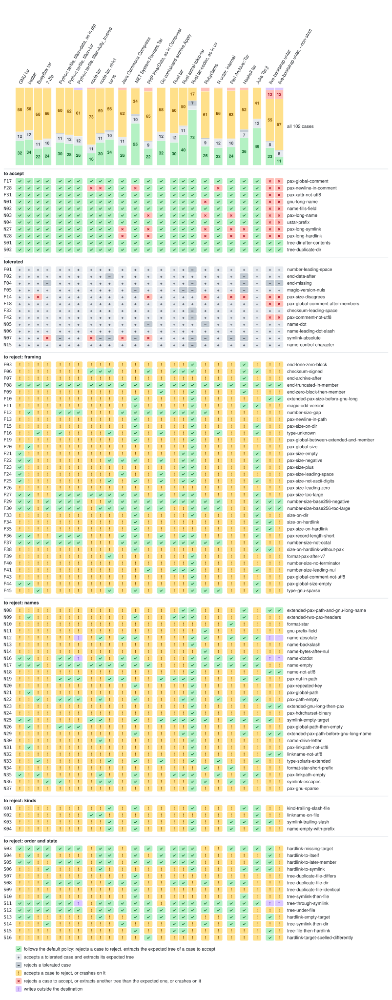

# What implementations make of the test suite

Generated by `matrix.py` from `matrix.json`: every case of [suite/archives/](../../suite/archives),
extracted by every implementation.

- ✅ follows the default policy: rejects a case to reject; extracts the expected tree of a case to accept
- ➕ accepts a tolerated case, and extracts its expected tree; ➖ rejects a tolerated case
- ⚠️ accepts a case to reject. The letter is the tree it extracts: in one row, the same letter is the same tree, and different letters are trees that differ; [MATRIX.md](MATRIX.md#trees) lists them. Without a letter, it crashes on the case, which is not a rejection
- ❌ rejects a case to accept, or extracts another tree than the expected one, or crashes on it
- 💥 writes outside the destination

| implementation | version |
|---|---|
| GNU tar | tar (GNU tar) 1.35 |
| bsdtar | bsdtar 3.8.11 - libarchive 3.8.11 |
| BusyBox tar | BusyBox v1.38.0, defconfig |
| 7-Zip | 7-Zip (z) 26.05 (x64) |
| Python tarfile, filter=data, as in pip | CPython 3.15.2 |
| Python tarfile, filter=tar | CPython 3.15.2 |
| Python tarfile, filter=fully_trusted | CPython 3.15.2 |
| node-tar | tar 7.5.22 |
| node-tar, strict | tar 7.5.22 |
| tar-fs | tar-fs 3.1.3, on tar-stream 3.2.2 |
| Java Commons Compress | Commons Compress 1.28.0, Expander, on Java 27.0.1.0.2 |
| .NET System.Formats.Tar | System.Formats.Tar of .NET 10.0.14, ExtractToDirectory |
| PHP PharData, as in Composer | PharData of PHP 8.5.12, as Composer's TarDownloader calls it |
| Go containerd archive.Apply | containerd v2.4.2, archive.Apply, of go1.27.3 |
| Rust tar | tar 0.4.46, unpack |
| Rust astral-tokio-tar | astral-tokio-tar 0.7.1, unpack |
| Rust tar-codec, as in uv | tar-codec 0.0.16, with the policies of uv 0.13 |
| RubyGems | RubyGems 4.0.20 of Ruby 4.0.9, extract_tar_gz |
| R untar, internal | utils::untar of R 4.6.2, tar = "internal" |
| Perl Archive::Tar | Archive::Tar 3.12 of Perl v5.44.0 |
| Haskell tar | tar 0.7.2.0, extract, of GHC 9.14 |
| Julia Tar.jl | Tar 1.10.0 of Julia 1.13.3 |
| live-bootstrap untar | mescc-tools-extra a151c245e512, as live-bootstrap pins it |
| live-bootstrap untar, --non-strict | mescc-tools-extra a151c245e512, as live-bootstrap pins it |

| case | GNU tar | bsdtar | BusyBox tar | 7-Zip | Python tarfile, filter=data, as in pip | Python tarfile, filter=tar | Python tarfile, filter=fully_trusted | node-tar | node-tar, strict | tar-fs | Java Commons Compress | .NET System.Formats.Tar | PHP PharData, as in Composer | Go containerd archive.Apply | Rust tar | Rust astral-tokio-tar | Rust tar-codec, as in uv | RubyGems | R untar, internal | Perl Archive::Tar | Haskell tar | Julia Tar.jl | live-bootstrap untar | live-bootstrap untar, --non-strict |
|---|---|---|---|---|---|---|---|---|---|---|---|---|---|---|---|---|---|---|---|---|---|---|---|---|
| **to accept** | | | | | | | | | | | | | | | | | | | | | | | | |
| [F17](https://stoppels.ch/tar/F17.html) pax-global-comment | ✅ | ✅ | ✅ | ✅ | ✅ | ✅ | ✅ | ✅ | ✅ | ✅ | ✅ | ✅ | ✅ | ✅ | ✅ | ✅ | ✅ | ✅ | ✅ | ✅ | ✅ | ✅ | ❌A | ❌A |
| [F28](https://stoppels.ch/tar/F28.html) pax-newline-in-comment | ✅ | ✅ | ✅ | ✅ | ✅ | ✅ | ✅ | ❌A | ❌A | ✅ | ✅ | ❌ | ✅ | ✅ | ✅ | ✅ | ✅ | ✅ | ❌A | ✅ | ✅ | ✅ | ❌B | ❌B |
| [F31](https://stoppels.ch/tar/F31.html) pax-xattr-not-utf8 | ✅ | ✅ | ✅ | ✅ | ✅ | ✅ | ✅ | ✅ | ✅ | ✅ | ✅ | ✅ | ✅ | ✅ | ✅ | ✅ | ✅ | ✅ | ✅ | ✅ | ✅ | ✅ | ❌A | ❌A |
| [F57](https://stoppels.ch/tar/F57.html) pax-newline-in-comment-path | ✅ | ✅ | ✅ | ✅ | ✅ | ✅ | ✅ | ❌A | ❌A | ✅ | ✅ | ❌ | ✅ | ✅ | ❌A | ✅ | ✅ | ✅ | ❌A | ✅ | ✅ | ✅ | ❌B | ❌B |
| [F58](https://stoppels.ch/tar/F58.html) pax-newline-in-comment-then-size | ✅ | ✅ | ✅ | ✅ | ✅ | ✅ | ✅ | ✅ | ✅ | ✅ | ✅ | ❌ | ✅ | ✅ | ✅ | ✅ | ✅ | ✅ | ❌A | ✅ | ✅ | ✅ | ❌B | ❌B |
| [F59](https://stoppels.ch/tar/F59.html) pax-nul-in-xattr | ✅ | ✅ | ✅ | ❌A | ✅ | ✅ | ✅ | ✅ | ✅ | ✅ | ✅ | ✅ | ❌A | ✅ | ✅ | ✅ | ✅ | ❌A | ❌ | ❌A | ✅ | ✅ | ❌B | ❌B |
| [F65](https://stoppels.ch/tar/F65.html) archive-without-members | ✅ | ✅ | ✅ | ✅ | ✅ | ✅ | ✅ | ❌ | ❌ | ✅ | ✅ | ✅ | ✅ | ✅ | ✅ | ✅ | ✅ | ✅ | ✅ | ❌ | ✅ | ✅ | ✅ | ✅ |
| [F79](https://stoppels.ch/tar/F79.html) number-uid-gid-empty | ✅ | ✅ | ✅ | ✅ | ✅ | ✅ | ✅ | ✅ | ✅ | ✅ | ✅ | ✅ | ✅ | ✅ | ✅ | ✅ | ✅ | ✅ | ✅ | ✅ | ✅ | ✅ | ✅ | ✅ |
| [F80](https://stoppels.ch/tar/F80.html) number-uid-base256 | ✅ | ✅ | ✅ | ✅ | ✅ | ✅ | ✅ | ✅ | ✅ | ✅ | ✅ | ✅ | ✅ | ✅ | ✅ | ✅ | ✅ | ✅ | ✅ | ✅ | ✅ | ✅ | ❌ | ❌ |
| [F81](https://stoppels.ch/tar/F81.html) pax-unknown-key | ✅ | ✅ | ✅ | ✅ | ✅ | ✅ | ✅ | ✅ | ✅ | ✅ | ✅ | ✅ | ✅ | ✅ | ✅ | ✅ | ❌ | ✅ | ✅ | ✅ | ✅ | ✅ | ❌A | ❌A |
| [F82](https://stoppels.ch/tar/F82.html) pax-times | ✅ | ✅ | ✅ | ✅ | ✅ | ✅ | ✅ | ✅ | ✅ | ✅ | ✅ | ✅ | ✅ | ✅ | ✅ | ✅ | ✅ | ✅ | ✅ | ✅ | ✅ | ✅ | ❌A | ❌A |
| [K07](https://stoppels.ch/tar/K07.html) dir-name-empty-with-prefix | ✅ | ✅ | ✅ | ✅ | ✅ | ✅ | ✅ | ✅ | ✅ | ✅ | ✅ | ✅ | ❌A | ✅ | ✅ | ✅ | ✅ | ✅ | ✅ | ❌ | ✅ | ✅ | ❌A | ❌A |
| [K09](https://stoppels.ch/tar/K09.html) file-executable | ✅ | ✅ | ✅ | ✅ | ✅ | ✅ | ✅ | ✅ | ✅ | ✅ | ❌A | ✅ | ✅ | ✅ | ✅ | ❌A | ✅ | ✅ | ✅ | ✅ | ✅ | ✅ | ❌A | ❌A |
| [K10](https://stoppels.ch/tar/K10.html) file-executable-group-other | ✅ | ✅ | ✅ | ✅ | ✅ | ✅ | ✅ | ✅ | ✅ | ✅ | ✅ | ✅ | ✅ | ✅ | ✅ | ✅ | ❌A | ✅ | ✅ | ✅ | ✅ | ✅ | ✅ | ✅ |
| [N01](https://stoppels.ch/tar/N01.html) gnu-long-name | ✅ | ✅ | ✅ | ✅ | ✅ | ✅ | ✅ | ✅ | ✅ | ✅ | ✅ | ✅ | ✅ | ✅ | ✅ | ✅ | ✅ | ❌A | ✅ | ✅ | ✅ | ✅ | ❌ | ❌ |
| [N02](https://stoppels.ch/tar/N02.html) name-fills-field | ✅ | ✅ | ✅ | ✅ | ✅ | ✅ | ✅ | ✅ | ✅ | ✅ | ✅ | ✅ | ✅ | ✅ | ✅ | ✅ | ✅ | ✅ | ✅ | ✅ | ✅ | ✅ | ❌A | ❌A |
| [N03](https://stoppels.ch/tar/N03.html) pax-long-name | ✅ | ✅ | ✅ | ✅ | ✅ | ✅ | ✅ | ✅ | ✅ | ✅ | ✅ | ✅ | ❌A | ✅ | ✅ | ✅ | ✅ | ❌A | ✅ | ❌A | ✅ | ✅ | ❌B | ❌B |
| [N04](https://stoppels.ch/tar/N04.html) ustar-prefix | ✅ | ✅ | ✅ | ✅ | ✅ | ✅ | ✅ | ✅ | ✅ | ✅ | ✅ | ✅ | ✅ | ✅ | ✅ | ✅ | ✅ | ✅ | ✅ | ✅ | ✅ | ✅ | ❌A | ❌A |
| [N27](https://stoppels.ch/tar/N27.html) pax-long-symlink | ✅ | ✅ | ✅ | ✅ | ✅ | ✅ | ✅ | ✅ | ✅ | ✅ | ❌A | ✅ | ❌B | ✅ | ✅ | ✅ | ✅ | ❌C | ✅ | ❌C | ❌D | ✅ | ❌E | ❌E |
| [N28](https://stoppels.ch/tar/N28.html) pax-long-hardlink | ✅ | ✅ | ✅ | ✅ | ✅ | ✅ | ✅ | ✅ | ✅ | ✅ | ❌A | ✅ | ❌B | ✅ | ✅ | ✅ | ✅ | ❌C | ✅ | ❌D | ❌E | ✅ | ❌ | ❌F |
| [N42](https://stoppels.ch/tar/N42.html) gnu-long-name-dir | ✅ | ✅ | ✅ | ✅ | ✅ | ✅ | ✅ | ✅ | ✅ | ✅ | ✅ | ✅ | ✅ | ✅ | ✅ | ✅ | ✅ | ❌A | ❌B | ✅ | ✅ | ✅ | ❌ | ❌ |
| [N43](https://stoppels.ch/tar/N43.html) pax-long-dir | ✅ | ✅ | ✅ | ✅ | ✅ | ✅ | ✅ | ✅ | ✅ | ✅ | ✅ | ✅ | ❌A | ✅ | ✅ | ✅ | ✅ | ❌B | ❌C | ❌B | ✅ | ✅ | ❌D | ❌D |
| [N44](https://stoppels.ch/tar/N44.html) pax-path-name-empty | ✅ | ✅ | ✅ | ✅ | ✅ | ✅ | ✅ | ✅ | ✅ | ✅ | ✅ | ✅ | ❌ | ✅ | ✅ | ✅ | ✅ | ❌ | ❌ | ❌ | ✅ | ✅ | ❌A | ❌A |
| [N45](https://stoppels.ch/tar/N45.html) gnu-long-name-field-slash | ✅ | ✅ | ✅ | ✅ | ✅ | ✅ | ✅ | ✅ | ✅ | ✅ | ✅ | ✅ | ✅ | ✅ | ✅ | ✅ | ✅ | ❌A | ❌ | ✅ | ✅ | ✅ | ❌ | ❌ |
| [N46](https://stoppels.ch/tar/N46.html) pax-linkpath-linkname-empty | ✅ | ✅ | ✅ | ✅ | ✅ | ✅ | ✅ | ❌A | ❌ | ✅ | ❌B | ✅ | ❌B | ✅ | ✅ | ✅ | ✅ | ❌ | ❌ | ❌ | ✅ | ✅ | ❌ | ❌C |
| [N47](https://stoppels.ch/tar/N47.html) gnu-long-link | ✅ | ✅ | ✅ | ✅ | ✅ | ✅ | ✅ | ✅ | ✅ | ✅ | ❌A | ✅ | ❌ | ✅ | ✅ | ✅ | ✅ | ❌B | ✅ | ❌C | ✅ | ✅ | ❌ | ❌ |
| [N54](https://stoppels.ch/tar/N54.html) pax-path-not-ascii | ✅ | ✅ | ✅ | ✅ | ✅ | ✅ | ✅ | ✅ | ✅ | ✅ | ✅ | ✅ | ❌A | ✅ | ✅ | ✅ | ✅ | ❌A | ✅ | ❌A | ❌B | ✅ | ❌C | ❌C |
| [N55](https://stoppels.ch/tar/N55.html) gnu-long-link-and-name | ✅ | ✅ | ✅ | ✅ | ✅ | ✅ | ✅ | ✅ | ✅ | ✅ | ❌A | ✅ | ❌ | ✅ | ✅ | ✅ | ✅ | ❌B | ✅ | ❌C | ✅ | ✅ | ❌ | ❌ |
| [N56](https://stoppels.ch/tar/N56.html) pax-path-equals-sign | ✅ | ✅ | ✅ | ✅ | ✅ | ✅ | ✅ | ✅ | ✅ | ✅ | ✅ | ✅ | ❌A | ✅ | ✅ | ✅ | ✅ | ❌A | ✅ | ❌A | ✅ | ✅ | ❌B | ❌B |
| [N57](https://stoppels.ch/tar/N57.html) ustar-prefix-fills-field | ✅ | ✅ | ✅ | ✅ | ✅ | ✅ | ✅ | ✅ | ✅ | ✅ | ✅ | ✅ | ✅ | ✅ | ✅ | ✅ | ✅ | ✅ | ✅ | ✅ | ✅ | ✅ | ❌A | ❌A |
| [N58](https://stoppels.ch/tar/N58.html) ustar-prefix-under-pax | ✅ | ✅ | ✅ | ✅ | ✅ | ✅ | ✅ | ✅ | ✅ | ✅ | ✅ | ❌A | ✅ | ✅ | ✅ | ✅ | ✅ | ✅ | ✅ | ✅ | ✅ | ✅ | ❌B | ❌B |
| [N59](https://stoppels.ch/tar/N59.html) symlink-target-dotdot-after-symlink | ✅ | ✅ | ✅ | ❌ | ❌A | ✅ | ✅ | ✅ | ✅ | ✅ | ❌B | ✅ | ❌C | ✅ | ✅ | ✅ | ❌ | ❌D | ✅ | ✅ | ✅ | ✅ | ✅ | ✅ |
| [N60](https://stoppels.ch/tar/N60.html) pax-global-name-directory | ✅ | ✅ | ✅ | ✅ | ✅ | ✅ | ✅ | ✅ | ✅ | ✅ | ✅ | ✅ | ✅ | ❌A | ❌A | ❌A | ✅ | ❌A | ✅ | ✅ | ✅ | ✅ | ❌B | ❌B |
| [S01](https://stoppels.ch/tar/S01.html) tree-dir-after-contents | ✅ | ✅ | ✅ | ✅ | ✅ | ✅ | ✅ | ✅ | ✅ | ✅ | ✅ | ✅ | ✅ | ✅ | ✅ | ✅ | ✅ | ✅ | ✅ | ✅ | ✅ | ✅ | ✅ | ✅ |
| [S02](https://stoppels.ch/tar/S02.html) tree-duplicate-dir | ✅ | ✅ | ✅ | ✅ | ✅ | ✅ | ✅ | ✅ | ✅ | ✅ | ✅ | ✅ | ✅ | ✅ | ✅ | ✅ | ✅ | ✅ | ✅ | ✅ | ✅ | ✅ | ✅ | ✅ |
| [S25](https://stoppels.ch/tar/S25.html) tree-dir-not-writable | ✅ | ✅ | ❌ | ✅ | ✅ | ✅ | ✅ | ✅ | ✅ | ❌ | ✅ | ✅ | ✅ | ❌ | ✅ | ✅ | ✅ | ❌ | ❌ | ✅ | ✅ | ✅ | ❌A | ❌A |
| **tolerated** | | | | | | | | | | | | | | | | | | | | | | | | |
| [F01](https://stoppels.ch/tar/F01.html) number-leading-space | ➕ | ➕ | ➕ | ➕ | ➕ | ➕ | ➕ | ➕ | ➕ | ➕ | ➕ | ➕ | ➕ | ➕ | ➕ | ➕ | ➖ | ➕ | ➕ | ➕ | ➕ | ➕ | ➕ | ➕ |
| [F02](https://stoppels.ch/tar/F02.html) end-data-after | ➕ | ➕ | ➕ | ➕ | ➕ | ➕ | ➕ | ➕ | ➕ | ➖ | ➕ | ➕ | ➕ | ➕ | ➕ | ➕ | ➕ | ➕ | ➕ | ➕ | ➖ | ➕ | ➕ | ➕ |
| [F04](https://stoppels.ch/tar/F04.html) end-missing | ➕ | ➕ | ➕ | ➖ | ➕ | ➕ | ➕ | ➕ | ➕ | ➕ | ➕ | ➕ | ➕ | ➕ | ➕ | ➕ | ➖ | ➕ | ➕ | ➕ | ➖ | ➕ | ➖ | ➖ |
| [F05](https://stoppels.ch/tar/F05.html) magic-version-nuls | ➕ | ➕ | ➕ | ➕ | ➕ | ➕ | ➕ | ➕ | ➕ | ➕ | ➕ | ➖ | ➕ | ➕ | ➕ | ➖ | ➖ | ➕ | ➕ | ➕ | ➖ | ➕ | ➕ | ➕ |
| [F14](https://stoppels.ch/tar/F14.html) pax-size-disagrees | ➕ | ➕ | ❌A | ➕ | ➕ | ➕ | ➕ | ➕ | ➕ | ➕ | ➕ | ➕ | ❌A | ➕ | ➕ | ➕ | ➕ | ❌A | ➕ | ❌A | ❌A | ➕ | ❌B | ❌B |
| [F18](https://stoppels.ch/tar/F18.html) pax-global-comment-after-members | ➕ | ➕ | ➕ | ➕ | ➕ | ➕ | ➕ | ➕ | ➕ | ➕ | ➕ | ➕ | ➕ | ➕ | ➕ | ➕ | ➕ | ➕ | ➕ | ➕ | ➕ | ➕ | ❌A | ❌A |
| [F32](https://stoppels.ch/tar/F32.html) checksum-leading-space | ➕ | ➕ | ➕ | ➕ | ➕ | ➕ | ➕ | ➕ | ➕ | ➕ | ➕ | ➕ | ➕ | ➕ | ➕ | ➕ | ➖ | ➕ | ➕ | ➕ | ➕ | ➕ | ➕ | ➕ |
| [F42](https://stoppels.ch/tar/F42.html) pax-comment-not-utf8 | ➕ | ➕ | ➕ | ➕ | ➕ | ➕ | ➕ | ➕ | ➕ | ➕ | ➕ | ➕ | ➕ | ➕ | ➕ | ➕ | ➖ | ➕ | ➕ | ➕ | ➕ | ➕ | ❌A | ❌A |
| [F43](https://stoppels.ch/tar/F43.html) pax-global-comment-not-utf8 | ➕ | ➕ | ➕ | ➕ | ➕ | ➕ | ➕ | ➕ | ➕ | ➕ | ➕ | ➕ | ➕ | ➕ | ➕ | ➕ | ➖ | ➕ | ➕ | ➕ | ➕ | ➕ | ❌A | ❌A |
| [F55](https://stoppels.ch/tar/F55.html) type-contiguous | ➕ | ➕ | ➕ | ➕ | ➕ | ➕ | ➕ | ➕ | ➕ | ➖ | ➕ | ➕ | ➕ | ➖ | ➕ | ➕ | ➕ | ❌A | ➖ | ❌A | ➕ | ➖ | ➕ | ➕ |
| [F56](https://stoppels.ch/tar/F56.html) number-size-base256 | ➕ | ➕ | ➕ | ➕ | ➕ | ➕ | ➕ | ➕ | ➕ | ➕ | ➕ | ➕ | ➖ | ➕ | ➕ | ➕ | ➖ | ➖ | ➖ | ➕ | ➕ | ➕ | ➖ | ➖ |
| [N05](https://stoppels.ch/tar/N05.html) name-dot | ➕ | ➕ | ➕ | ➕ | ➕ | ➕ | ➕ | ➕ | ➕ | ➕ | ➕ | ➕ | ➖ | ➕ | ➕ | ➕ | ➕ | ➖ | ➕ | ➕ | ➕ | ➕ | ➕ | ➕ |
| [N06](https://stoppels.ch/tar/N06.html) name-leading-dot-slash | ➕ | ➕ | ➕ | ➕ | ➕ | ➕ | ➕ | ➕ | ➕ | ➕ | ➕ | ➕ | ➕ | ➕ | ➕ | ➕ | ➕ | ➕ | ➕ | ➕ | ➕ | ➕ | ➕ | ➕ |
| [N07](https://stoppels.ch/tar/N07.html) symlink-absolute | ➕ | ➕ | ➕ | ❌A | ➖ | ➕ | ➕ | ❌B | ➖ | ➖ | ❌C | ➖ | ❌C | ➕ | ➕ | ➕ | ➖ | ➖ | ➕ | ➖ | ➖ | ➕ | ➕ | ➕ |
| [N15](https://stoppels.ch/tar/N15.html) name-control-character | ➕ | ➕ | ➕ | ➕ | ➕ | ➕ | ➕ | ➕ | ➕ | ➕ | ➕ | ➕ | ➕ | ➕ | ➕ | ➕ | ➖ | ➕ | ➕ | ➕ | ➕ | ➕ | ➕ | ➕ |
| [N35](https://stoppels.ch/tar/N35.html) symlink-escapes | ➕ | ➕ | ➕ | ➖ | ➖ | ➕ | ➕ | ❌A | ➖ | ➖ | ❌B | ➖ | ❌B | ➕ | ➕ | ➕ | ➖ | ➖ | ➕ | ➖ | ➖ | ➕ | ➕ | ➕ |
| [N49](https://stoppels.ch/tar/N49.html) name-double-slash | ➕ | ➕ | ➕ | ➕ | ➕ | ➕ | ➕ | ➕ | ➕ | ➕ | ➕ | ➕ | ➕ | ➕ | ➕ | ➕ | ➕ | ➕ | ➕ | ➕ | ➕ | ➕ | ❌A | ❌A |
| [N50](https://stoppels.ch/tar/N50.html) name-dot-component | ➕ | ➕ | ➕ | ➕ | ➕ | ➕ | ➕ | ➕ | ➕ | ➕ | ➕ | ➕ | ➕ | ➕ | ➕ | ➕ | ➕ | ➕ | ➖ | ➕ | ➕ | ➕ | ➕ | ➕ |
| [S16](https://stoppels.ch/tar/S16.html) hardlink-target-spelled-differently | ➕ | ➕ | ➕ | ➕ | ➕ | ➕ | ➕ | ➕ | ➕ | ➕ | ❌A | ➕ | ➖ | ➕ | ➕ | ➕ | ➕ | ❌B | ➕ | ➕ | ➕ | ➕ | ➖ | ❌B |
| **to reject: framing** | | | | | | | | | | | | | | | | | | | | | | | | |
| [F03](https://stoppels.ch/tar/F03.html) end-lone-zero-block | ⚠️A | ⚠️A | ⚠️A | ⚠️A | ⚠️A | ⚠️A | ⚠️A | ⚠️A | ⚠️A | ⚠️A | ⚠️A | ⚠️A | ⚠️A | ⚠️A | ⚠️A | ⚠️A | ✅ | ⚠️A | ⚠️A | ⚠️A | ✅ | ⚠️A | ⚠️A | ⚠️A |
| [F06](https://stoppels.ch/tar/F06.html) checksum-signed | ⚠️A | ⚠️A | ⚠️A | ⚠️A | ⚠️A | ⚠️A | ⚠️A | ✅ | ✅ | ✅ | ⚠️A | ⚠️A | ✅ | ⚠️A | ✅ | ✅ | ✅ | ⚠️A | ⚠️A | ⚠️A | ✅ | ✅ | ⚠️A | ⚠️A |
| [F07](https://stoppels.ch/tar/F07.html) end-archive-after | ⚠️A | ⚠️A | ⚠️A | ⚠️A | ⚠️A | ⚠️A | ⚠️A | ⚠️A | ⚠️A | ⚠️B | ⚠️A | ⚠️A | ⚠️A | ⚠️A | ⚠️A | ⚠️A | ⚠️A | ⚠️A | ⚠️A | ⚠️B | ✅ | ⚠️A | ⚠️A | ⚠️A |
| [F08](https://stoppels.ch/tar/F08.html) end-truncated-in-member | ✅ | ✅ | ✅ | ✅ | ✅ | ✅ | ✅ | ✅ | ✅ | ✅ | ✅ | ✅ | ✅ | ✅ | ✅ | ✅ | ✅ | ✅ | ✅ | ✅ | ✅ | ✅ | ✅ | ✅ |
| [F09](https://stoppels.ch/tar/F09.html) end-zero-block-then-member | ⚠️A | ⚠️A | ⚠️B | ⚠️A | ⚠️A | ⚠️A | ⚠️A | ⚠️B | ⚠️B | ⚠️B | ⚠️A | ⚠️A | ⚠️A | ✅ | ⚠️A | ⚠️A | ✅ | ⚠️A | ⚠️A | ⚠️B | ✅ | ⚠️A | ⚠️A | ⚠️A |
| [F10](https://stoppels.ch/tar/F10.html) extended-pax-size-before-gnu-long | ⚠️A | ⚠️A | ⚠️B | ⚠️A | ⚠️C | ⚠️C | ⚠️C | ⚠️A | ⚠️A | ⚠️A | ⚠️A | ✅ | ⚠️B | ⚠️A | ⚠️A | ⚠️A | ✅ | ⚠️D | ⚠️A | ⚠️B | ⚠️B | ⚠️A | ✅ | ✅ |
| [F11](https://stoppels.ch/tar/F11.html) magic-odd-version | ⚠️A | ⚠️A | ⚠️A | ⚠️A | ⚠️A | ⚠️A | ⚠️A | ⚠️A | ⚠️A | ⚠️A | ⚠️A | ✅ | ⚠️A | ⚠️A | ⚠️A | ⚠️A | ✅ | ⚠️A | ⚠️A | ⚠️A | ✅ | ✅ | ⚠️A | ⚠️A |
| [F12](https://stoppels.ch/tar/F12.html) number-size-gap | ⚠️A | ✅ | ⚠️A | ⚠️A | ✅ | ✅ | ✅ | ⚠️A | ⚠️A | ⚠️A | ✅ | ✅ | ✅ | ✅ | ✅ | ✅ | ✅ | ✅ | ⚠️B | ⚠️A | ⚠️A | ⚠️A | ⚠️A | ⚠️A |
| [F13](https://stoppels.ch/tar/F13.html) pax-newline-in-path | ⚠️A | ⚠️A | ⚠️A | ⚠️A | ⚠️A | ⚠️A | ⚠️A | ⚠️B | ⚠️B | ⚠️A | ⚠️A | ✅ | ⚠️B | ⚠️A | ⚠️B | ⚠️A | ✅ | ⚠️B | ⚠️ | ⚠️B | ⚠️A | ⚠️A | ⚠️C | ⚠️C |
| [F15](https://stoppels.ch/tar/F15.html) pax-size-on-dir | ⚠️A | ⚠️A | ⚠️A | ⚠️B | ⚠️A | ⚠️A | ⚠️A | ⚠️A | ⚠️A | ⚠️A | ⚠️B | ✅ | ⚠️A | ⚠️A | ⚠️B | ⚠️B | ✅ | ⚠️A | ⚠️C | ⚠️A | ⚠️A | ✅ | ⚠️D | ⚠️D |
| [F16](https://stoppels.ch/tar/F16.html) type-unknown | ⚠️A | ⚠️A | ✅ | ⚠️A | ✅ | ⚠️A | ⚠️A | ⚠️B | ⚠️B | ✅ | ⚠️A | ✅ | ⚠️A | ✅ | ⚠️A | ⚠️A | ✅ | ⚠️B | ✅ | ⚠️A | ⚠️B | ✅ | ⚠️A | ⚠️A |
| [F19](https://stoppels.ch/tar/F19.html) pax-global-between-extended-and-member | ⚠️A | ⚠️A | ⚠️A | ⚠️A | ⚠️A | ⚠️A | ⚠️A | ⚠️A | ⚠️A | ⚠️A | ⚠️A | ✅ | ⚠️B | ⚠️B | ⚠️B | ⚠️B | ✅ | ⚠️B | ⚠️A | ⚠️B | ⚠️B | ⚠️A | ⚠️C | ⚠️C |
| [F20](https://stoppels.ch/tar/F20.html) pax-global-size | ⚠️A | ✅ | ⚠️B | ⚠️B | ⚠️C | ⚠️C | ⚠️C | ⚠️A | ⚠️A | ⚠️B | ⚠️A | ⚠️B | ⚠️B | ⚠️B | ⚠️B | ⚠️B | ✅ | ⚠️B | ⚠️B | ⚠️B | ⚠️B | ⚠️A | ⚠️D | ⚠️D |
| [F21](https://stoppels.ch/tar/F21.html) pax-size-empty | ✅ | ⚠️A | ⚠️B | ⚠️B | ⚠️A | ⚠️A | ⚠️A | ⚠️A | ⚠️A | ⚠️B | ⚠️B | ⚠️B | ⚠️B | ⚠️B | ⚠️B | ✅ | ✅ | ⚠️B | ⚠️ | ⚠️B | ⚠️B | ✅ | ⚠️C | ⚠️C |
| [F22](https://stoppels.ch/tar/F22.html) pax-size-negative | ✅ | ✅ | ⚠️A | ⚠️A | ⚠️B | ⚠️B | ⚠️B | ⚠️A | ⚠️A | ✅ | ✅ | ✅ | ⚠️A | ✅ | ⚠️A | ✅ | ✅ | ⚠️A | ⚠️ | ⚠️A | ⚠️A | ✅ | ⚠️C | ⚠️C |
| [F23](https://stoppels.ch/tar/F23.html) pax-size-plus | ✅ | ⚠️A | ⚠️A | ⚠️A | ⚠️B | ⚠️B | ⚠️B | ⚠️B | ⚠️B | ⚠️B | ⚠️B | ⚠️B | ⚠️A | ⚠️B | ⚠️B | ✅ | ✅ | ⚠️A | ⚠️B | ⚠️A | ⚠️A | ✅ | ⚠️C | ⚠️C |
| [F24](https://stoppels.ch/tar/F24.html) pax-size-leading-space | ✅ | ⚠️A | ⚠️B | ⚠️B | ⚠️A | ⚠️A | ⚠️A | ⚠️A | ⚠️A | ⚠️A | ✅ | ⚠️A | ⚠️B | ✅ | ⚠️B | ✅ | ✅ | ⚠️B | ⚠️A | ⚠️B | ⚠️B | ⚠️A | ⚠️C | ⚠️C |
| [F25](https://stoppels.ch/tar/F25.html) pax-size-not-ascii-digits | ✅ | ⚠️A | ⚠️A | ⚠️A | ⚠️B | ⚠️B | ⚠️B | ⚠️A | ⚠️A | ✅ | ⚠️B | ✅ | ⚠️A | ✅ | ⚠️A | ✅ | ✅ | ⚠️A | ⚠️ | ⚠️A | ⚠️A | ✅ | ⚠️C | ⚠️C |
| [F26](https://stoppels.ch/tar/F26.html) pax-size-leading-zero | ⚠️A | ⚠️A | ⚠️B | ⚠️A | ⚠️A | ⚠️A | ⚠️A | ⚠️A | ⚠️A | ⚠️A | ⚠️A | ⚠️A | ⚠️B | ⚠️A | ⚠️A | ⚠️A | ✅ | ⚠️B | ⚠️A | ⚠️B | ⚠️B | ⚠️A | ⚠️C | ⚠️C |
| [F27](https://stoppels.ch/tar/F27.html) pax-size-too-large | ✅ | ✅ | ⚠️A | ⚠️A | ✅ | ✅ | ✅ | ✅ | ✅ | ✅ | ✅ | ✅ | ⚠️A | ✅ | ⚠️A | ✅ | ✅ | ⚠️A | ⚠️ | ⚠️A | ⚠️A | ✅ | ⚠️B | ⚠️B |
| [F29](https://stoppels.ch/tar/F29.html) number-size-base256-negative | ✅ | ✅ | ⚠️A | ✅ | ✅ | ✅ | ✅ | ⚠️B | ⚠️B | ✅ | ✅ | ✅ | ✅ | ✅ | ✅ | ✅ | ✅ | ✅ | ✅ | ⚠️B | ⚠️A | ✅ | ✅ | ✅ |
| [F30](https://stoppels.ch/tar/F30.html) number-size-base256-too-large | ✅ | ✅ | ⚠️A | ✅ | ✅ | ✅ | ✅ | ⚠️B | ✅ | ✅ | ✅ | ✅ | ✅ | ✅ | ⚠️A | ⚠️A | ✅ | ✅ | ✅ | ⚠️B | ⚠️A | ✅ | ✅ | ✅ |
| [F33](https://stoppels.ch/tar/F33.html) size-on-dir | ⚠️A | ⚠️A | ⚠️A | ⚠️A | ⚠️A | ⚠️A | ⚠️A | ⚠️A | ⚠️A | ⚠️A | ⚠️B | ✅ | ⚠️A | ⚠️A | ⚠️B | ⚠️B | ✅ | ⚠️B | ⚠️A | ⚠️A | ⚠️B | ✅ | ⚠️A | ⚠️A |
| [F34](https://stoppels.ch/tar/F34.html) size-on-hardlink | ⚠️A | ⚠️B | ⚠️A | ⚠️A | ⚠️A | ⚠️A | ⚠️A | ⚠️C | ⚠️C | ⚠️C | ⚠️D | ✅ | ⚠️E | ⚠️A | ⚠️C | ⚠️C | ✅ | ⚠️F | ⚠️A | ⚠️A | ⚠️C | ✅ | ✅ | ⚠️G |
| [F35](https://stoppels.ch/tar/F35.html) pax-size-on-hardlink | ⚠️A | ⚠️B | ⚠️A | ⚠️C | ⚠️A | ⚠️A | ⚠️A | ⚠️C | ⚠️C | ⚠️C | ⚠️D | ✅ | ⚠️E | ⚠️A | ⚠️C | ⚠️C | ✅ | ⚠️F | ⚠️G | ⚠️A | ⚠️A | ✅ | ✅ | ⚠️H |
| [F36](https://stoppels.ch/tar/F36.html) pax-record-length-short | ✅ | ✅ | ⚠️A | ⚠️B | ✅ | ✅ | ✅ | ⚠️B | ⚠️B | ⚠️A | ✅ | ✅ | ⚠️B | ✅ | ⚠️B | ✅ | ✅ | ⚠️B | ⚠️C | ⚠️B | ⚠️B | ✅ | ⚠️D | ⚠️D |
| [F37](https://stoppels.ch/tar/F37.html) number-size-not-octal | ✅ | ✅ | ✅ | ✅ | ✅ | ✅ | ✅ | ⚠️A | ⚠️A | ⚠️A | ✅ | ✅ | ✅ | ✅ | ✅ | ✅ | ✅ | ✅ | ✅ | ⚠️A | ⚠️B | ✅ | ⚠️A | ⚠️A |
| [F38](https://stoppels.ch/tar/F38.html) size-on-hardlink-without-pax | ⚠️A | ⚠️A | ⚠️A | ⚠️A | ⚠️A | ⚠️A | ⚠️A | ⚠️B | ⚠️B | ⚠️B | ⚠️C | ✅ | ⚠️D | ⚠️A | ⚠️B | ⚠️B | ✅ | ⚠️E | ⚠️A | ⚠️A | ⚠️B | ✅ | ✅ | ⚠️E |
| [F39](https://stoppels.ch/tar/F39.html) format-pax-after-v7 | ⚠️A | ⚠️A | ⚠️A | ⚠️A | ⚠️A | ⚠️A | ⚠️A | ⚠️A | ⚠️A | ✅ | ⚠️A | ⚠️A | ⚠️B | ⚠️A | ⚠️A | ⚠️A | ✅ | ⚠️B | ⚠️A | ⚠️B | ⚠️A | ⚠️A | ⚠️C | ⚠️C |
| [F40](https://stoppels.ch/tar/F40.html) number-size-no-terminator | ⚠️A | ⚠️A | ⚠️A | ⚠️A | ⚠️A | ⚠️A | ⚠️A | ⚠️A | ⚠️A | ⚠️A | ⚠️A | ⚠️A | ⚠️A | ⚠️A | ⚠️A | ⚠️A | ✅ | ⚠️A | ⚠️A | ⚠️A | ⚠️A | ⚠️A | ⚠️A | ⚠️A |
| [F41](https://stoppels.ch/tar/F41.html) number-size-leading-nul | ⚠️A | ⚠️B | ⚠️B | ⚠️B | ⚠️B | ⚠️B | ⚠️B | ⚠️B | ⚠️B | ⚠️A | ⚠️B | ⚠️B | ✅ | ⚠️A | ✅ | ✅ | ✅ | ⚠️A | ⚠️B | ⚠️B | ⚠️B | ✅ | ⚠️A | ⚠️A |
| [F44](https://stoppels.ch/tar/F44.html) pax-global-size-empty | ✅ | ✅ | ⚠️A | ⚠️A | ⚠️B | ⚠️B | ⚠️B | ⚠️C | ⚠️C | ⚠️A | ⚠️A | ⚠️A | ⚠️A | ⚠️A | ⚠️A | ⚠️A | ✅ | ⚠️A | ⚠️A | ⚠️A | ⚠️A | ✅ | ⚠️D | ⚠️D |
| [F45](https://stoppels.ch/tar/F45.html) type-gnu-sparse | ⚠️A | ⚠️A | ✅ | ⚠️A | ⚠️A | ⚠️A | ⚠️A | ⚠️B | ⚠️B | ✅ | ⚠️A | ✅ | ⚠️C | ✅ | ⚠️A | ⚠️A | ✅ | ✅ | ✅ | ⚠️C | ⚠️B | ✅ | ⚠️C | ⚠️C |
| [F46](https://stoppels.ch/tar/F46.html) pax-size-on-symlink | ⚠️A | ⚠️A | ⚠️A | ⚠️B | ⚠️A | ⚠️A | ⚠️A | ⚠️C | ⚠️C | ⚠️C | ⚠️D | ✅ | ⚠️E | ⚠️A | ⚠️C | ⚠️C | ✅ | ⚠️F | ✅ | ⚠️A | ⚠️A | ✅ | ⚠️G | ⚠️G |
| [F47](https://stoppels.ch/tar/F47.html) checksum-wrong-after-first-member | ✅ | ⚠️A | ✅ | ✅ | ⚠️B | ⚠️B | ⚠️B | ⚠️A | ✅ | ✅ | ⚠️C | ⚠️B | ✅ | ✅ | ✅ | ✅ | ✅ | ⚠️C | ⚠️C | ⚠️A | ✅ | ✅ | ✅ | ✅ |
| [F48](https://stoppels.ch/tar/F48.html) pax-record-length-plus | ✅ | ✅ | ⚠️A | ⚠️A | ✅ | ✅ | ✅ | ⚠️A | ⚠️A | ⚠️B | ✅ | ✅ | ⚠️A | ⚠️B | ⚠️B | ⚠️B | ✅ | ⚠️A | ⚠️C | ⚠️A | ⚠️B | ✅ | ⚠️D | ⚠️D |
| [F49](https://stoppels.ch/tar/F49.html) pax-record-empty-line | ✅ | ✅ | ⚠️A | ⚠️A | ✅ | ✅ | ✅ | ⚠️B | ⚠️B | ⚠️C | ⚠️B | ✅ | ⚠️A | ✅ | ⚠️A | ✅ | ✅ | ⚠️A | ⚠️B | ⚠️A | ⚠️A | ✅ | ⚠️D | ⚠️D |
| [F50](https://stoppels.ch/tar/F50.html) pax-size-underscore | ✅ | ⚠️A | ⚠️B | ⚠️B | ⚠️C | ⚠️C | ⚠️C | ⚠️B | ⚠️B | ⚠️A | ✅ | ✅ | ⚠️B | ✅ | ⚠️B | ✅ | ✅ | ⚠️B | ⚠️ | ⚠️B | ⚠️B | ✅ | ⚠️D | ⚠️D |
| [F51](https://stoppels.ch/tar/F51.html) number-size-plus | ✅ | ✅ | ⚠️A | ✅ | ⚠️A | ⚠️A | ⚠️A | ⚠️A | ⚠️A | ⚠️A | ✅ | ✅ | ✅ | ✅ | ⚠️A | ⚠️A | ✅ | ✅ | ✅ | ⚠️B | ✅ | ✅ | ⚠️A | ⚠️A |
| [F52](https://stoppels.ch/tar/F52.html) type-gnu-volume-label | ⚠️A | ⚠️A | ⚠️A | ⚠️B | ✅ | ⚠️B | ⚠️B | ⚠️A | ⚠️A | ✅ | ⚠️B | ✅ | ⚠️B | ✅ | ⚠️B | ⚠️B | ✅ | ⚠️A | ✅ | ⚠️A | ⚠️A | ✅ | ⚠️B | ⚠️B |
| [F53](https://stoppels.ch/tar/F53.html) type-gnu-old-long-name | ⚠️A | ⚠️A | ✅ | ⚠️A | ✅ | ⚠️A | ⚠️A | ⚠️B | ⚠️B | ⚠️B | ⚠️A | ✅ | ⚠️A | ✅ | ⚠️A | ⚠️A | ✅ | ⚠️C | ✅ | ⚠️A | ⚠️C | ✅ | ✅ | ✅ |
| [F54](https://stoppels.ch/tar/F54.html) format-pax-header-without-magic | ⚠️A | ⚠️A | ⚠️A | ⚠️A | ⚠️A | ⚠️A | ⚠️A | ⚠️A | ⚠️A | ✅ | ⚠️A | ⚠️A | ⚠️B | ⚠️A | ⚠️B | ✅ | ✅ | ⚠️B | ⚠️A | ⚠️B | ⚠️A | ⚠️A | ⚠️C | ⚠️C |
| [F61](https://stoppels.ch/tar/F61.html) number-uid-not-octal | ✅ | ⚠️A | ✅ | ⚠️A | ⚠️B | ⚠️B | ⚠️B | ⚠️A | ⚠️A | ⚠️A | ✅ | ✅ | ⚠️A | ✅ | ⚠️A | ⚠️A | ✅ | ✅ | ⚠️A | ⚠️A | ⚠️A | ⚠️A | ⚠️A | ⚠️A |
| [F62](https://stoppels.ch/tar/F62.html) pax-schily-realsize | ⚠️A | ✅ | ⚠️A | ⚠️A | ⚠️A | ⚠️A | ⚠️A | ⚠️A | ⚠️A | ⚠️A | ⚠️A | ⚠️A | ⚠️A | ⚠️A | ⚠️A | ⚠️A | ⚠️A | ⚠️A | ⚠️A | ⚠️A | ⚠️A | ⚠️A | ⚠️B | ⚠️B |
| [F63](https://stoppels.ch/tar/F63.html) end-unpadded | ✅ | ✅ | ⚠️A | ✅ | ✅ | ✅ | ✅ | ✅ | ✅ | ✅ | ✅ | ✅ | ✅ | ⚠️A | ✅ | ✅ | ✅ | ⚠️A | ✅ | ✅ | ✅ | ✅ | ✅ | ✅ |
| [F64](https://stoppels.ch/tar/F64.html) end-truncated-in-header | ⚠️A | ✅ | ✅ | ✅ | ⚠️A | ⚠️A | ⚠️A | ⚠️A | ⚠️A | ✅ | ⚠️A | ✅ | ✅ | ✅ | ✅ | ✅ | ✅ | ⚠️B | ✅ | ⚠️A | ✅ | ✅ | ✅ | ✅ |
| [F66](https://stoppels.ch/tar/F66.html) archive-no-bytes | ✅ | ⚠️A | ✅ | ✅ | ✅ | ✅ | ✅ | ✅ | ✅ | ⚠️A | ⚠️A | ⚠️A | ✅ | ⚠️A | ⚠️A | ⚠️A | ✅ | ⚠️A | ⚠️A | ✅ | ✅ | ⚠️A | ✅ | ✅ |
| [F67](https://stoppels.ch/tar/F67.html) extended-without-member | ⚠️A | ⚠️A | ✅ | ✅ | ✅ | ✅ | ✅ | ⚠️A | ⚠️A | ⚠️A | ✅ | ⚠️A | ⚠️A | ⚠️A | ✅ | ✅ | ✅ | ⚠️A | ⚠️A | ⚠️A | ⚠️A | ✅ | ⚠️B | ⚠️B |
| [F68](https://stoppels.ch/tar/F68.html) size-on-symlink | ⚠️A | ⚠️A | ⚠️A | ⚠️B | ⚠️A | ⚠️A | ⚠️A | ⚠️C | ⚠️C | ⚠️C | ⚠️D | ✅ | ⚠️E | ⚠️A | ⚠️C | ⚠️C | ✅ | ⚠️F | ⚠️A | ⚠️A | ⚠️C | ✅ | ⚠️C | ⚠️C |
| [F69](https://stoppels.ch/tar/F69.html) number-size-octal-prefix | ✅ | ✅ | ✅ | ✅ | ⚠️A | ⚠️A | ⚠️A | ⚠️B | ⚠️B | ⚠️B | ✅ | ✅ | ✅ | ✅ | ✅ | ✅ | ✅ | ✅ | ✅ | ⚠️A | ✅ | ✅ | ⚠️B | ⚠️B |
| [F70](https://stoppels.ch/tar/F70.html) number-size-minus | ✅ | ✅ | ⚠️A | ✅ | ✅ | ✅ | ✅ | ⚠️B | ⚠️B | ✅ | ✅ | ✅ | ✅ | ✅ | ✅ | ✅ | ✅ | ✅ | ✅ | ⚠️B | ✅ | ✅ | ⚠️A | ⚠️A |
| [F71](https://stoppels.ch/tar/F71.html) number-size-base256-marker | ✅ | ✅ | ⚠️A | ✅ | ✅ | ✅ | ✅ | ⚠️B | ✅ | ✅ | ⚠️A | ✅ | ✅ | ✅ | ⚠️A | ⚠️A | ✅ | ✅ | ✅ | ⚠️C | ✅ | ✅ | ✅ | ✅ |
| [F72](https://stoppels.ch/tar/F72.html) pax-record-length-wraps | ✅ | ✅ | ⚠️A | ⚠️A | ✅ | ✅ | ✅ | ⚠️A | ⚠️A | ⚠️B | ⚠️C | ✅ | ⚠️A | ✅ | ⚠️A | ✅ | ✅ | ⚠️A | ⚠️C | ⚠️A | ⚠️C | ⚠️ | ⚠️D | ⚠️D |
| [F73](https://stoppels.ch/tar/F73.html) pax-record-without-equals | ✅ | ✅ | ⚠️A | ⚠️B | ✅ | ✅ | ✅ | ⚠️A | ⚠️A | ⚠️B | ✅ | ✅ | ⚠️B | ✅ | ⚠️A | ✅ | ✅ | ⚠️B | ⚠️A | ⚠️B | ⚠️B | ✅ | ⚠️C | ⚠️C |
| [F74](https://stoppels.ch/tar/F74.html) pax-size-twice | ⚠️A | ⚠️A | ⚠️B | ⚠️A | ⚠️A | ⚠️A | ⚠️A | ⚠️A | ⚠️A | ⚠️A | ⚠️A | ✅ | ⚠️B | ⚠️A | ⚠️B | ⚠️A | ✅ | ⚠️B | ⚠️B | ⚠️B | ⚠️B | ⚠️A | ⚠️C | ⚠️C |
| [F75](https://stoppels.ch/tar/F75.html) pax-size-decimal-point | ✅ | ⚠️A | ⚠️B | ⚠️B | ⚠️B | ⚠️B | ⚠️B | ⚠️A | ⚠️A | ⚠️A | ✅ | ✅ | ⚠️B | ✅ | ⚠️B | ✅ | ✅ | ⚠️B | ⚠️A | ⚠️B | ⚠️B | ✅ | ⚠️C | ⚠️C |
| [F76](https://stoppels.ch/tar/F76.html) checksum-byte-after-nul | ⚠️A | ⚠️B | ⚠️A | ⚠️A | ⚠️A | ⚠️A | ⚠️A | ⚠️A | ⚠️A | ⚠️A | ✅ | ⚠️A | ⚠️A | ⚠️A | ⚠️A | ⚠️A | ✅ | ✅ | ⚠️A | ⚠️A | ⚠️A | ⚠️A | ⚠️A | ⚠️A |
| [F77](https://stoppels.ch/tar/F77.html) checksum-leading-nul | ⚠️A | ⚠️B | ✅ | ✅ | ⚠️C | ⚠️C | ⚠️C | ⚠️B | ✅ | ⚠️A | ⚠️A | ⚠️C | ✅ | ⚠️A | ✅ | ✅ | ✅ | ⚠️A | ⚠️A | ⚠️B | ✅ | ✅ | ⚠️A | ⚠️A |
| [F78](https://stoppels.ch/tar/F78.html) pax-nul-in-key | ✅ | ⚠️A | ⚠️A | ⚠️B | ⚠️A | ⚠️A | ⚠️A | ⚠️A | ⚠️A | ⚠️A | ⚠️A | ⚠️A | ⚠️B | ✅ | ⚠️A | ⚠️A | ✅ | ⚠️B | ⚠️ | ⚠️B | ⚠️A | ⚠️A | ⚠️C | ⚠️C |
| [F83](https://stoppels.ch/tar/F83.html) size-on-fifo | ⚠️A | ⚠️A | ⚠️A | ⚠️B | ✅ | ⚠️A | ⚠️A | ⚠️C | ✅ | ✅ | ⚠️B | ✅ | ⚠️D | ⚠️A | ⚠️B | ⚠️B | ✅ | ⚠️C | ⚠️E | ⚠️A | ⚠️C | ✅ | ✅ | ⚠️C |
| [N48](https://stoppels.ch/tar/N48.html) magic-gnu-version-00 | ⚠️A | ⚠️B | ⚠️B | ⚠️B | ⚠️B | ⚠️B | ⚠️B | ⚠️A | ⚠️A | ✅ | ✅ | ✅ | ⚠️B | ⚠️A | ⚠️A | ⚠️A | ✅ | ⚠️B | ⚠️B | ⚠️B | ✅ | ⚠️B | ⚠️A | ⚠️A |
| **to reject: names** | | | | | | | | | | | | | | | | | | | | | | | | |
| [N08](https://stoppels.ch/tar/N08.html) extended-pax-path-and-gnu-long-name | ⚠️A | ⚠️A | ⚠️A | ⚠️A | ⚠️B | ⚠️B | ⚠️B | ⚠️A | ⚠️A | ⚠️A | ⚠️B | ⚠️C | ⚠️B | ⚠️B | ⚠️B | ✅ | ✅ | ⚠️C | ⚠️A | ⚠️C | ✅ | ⚠️A | ✅ | ✅ |
| [N09](https://stoppels.ch/tar/N09.html) extended-two-pax-headers | ⚠️A | ✅ | ⚠️A | ⚠️A | ⚠️B | ⚠️B | ⚠️B | ⚠️A | ⚠️A | ⚠️A | ⚠️B | ✅ | ⚠️C | ⚠️A | ✅ | ✅ | ✅ | ⚠️C | ⚠️A | ⚠️C | ✅ | ⚠️A | ⚠️D | ⚠️D |
| [N10](https://stoppels.ch/tar/N10.html) format-star | ⚠️A | ⚠️A | ⚠️A | ⚠️A | ⚠️A | ⚠️A | ⚠️A | ⚠️A | ⚠️A | ⚠️A | ⚠️B | ⚠️A | ⚠️A | ⚠️B | ⚠️A | ⚠️A | ✅ | ⚠️C | ⚠️A | ✅ | ⚠️A | ⚠️A | ⚠️D | ⚠️D |
| [N11](https://stoppels.ch/tar/N11.html) gnu-prefix-field | ⚠️A | ⚠️A | ⚠️B | ⚠️B | ⚠️B | ⚠️B | ⚠️B | ⚠️A | ⚠️A | ⚠️A | ⚠️A | ⚠️A | ⚠️B | ⚠️A | ⚠️A | ⚠️A | ⚠️A | ✅ | ⚠️ | ⚠️B | ⚠️B | ⚠️B | ⚠️A | ⚠️A |
| [N12](https://stoppels.ch/tar/N12.html) name-absolute | ⚠️A | ⚠️A | ⚠️A | ⚠️A | ⚠️A | ⚠️A | 💥 | ⚠️A | ✅ | ⚠️A | ✅ | ✅ | ⚠️A | ⚠️A | ⚠️A | ⚠️A | ✅ | ✅ | ⚠️A | ✅ | ✅ | ✅ | 💥 | 💥 |
| [N13](https://stoppels.ch/tar/N13.html) name-backslash | ⚠️A | ⚠️A | ⚠️A | ⚠️A | ⚠️A | ⚠️A | ⚠️A | ⚠️A | ⚠️A | ⚠️A | ⚠️A | ⚠️A | ⚠️A | ⚠️A | ⚠️A | ⚠️A | ✅ | ⚠️A | ⚠️A | ⚠️A | ⚠️A | ⚠️A | ⚠️A | ⚠️A |
| [N14](https://stoppels.ch/tar/N14.html) name-bytes-after-nul | ⚠️A | ⚠️A | ⚠️A | ⚠️A | ⚠️A | ⚠️A | ⚠️A | ⚠️A | ⚠️A | ⚠️A | ⚠️A | ⚠️A | ⚠️A | ⚠️A | ⚠️A | ⚠️A | ⚠️A | ✅ | ⚠️ | ⚠️A | ⚠️A | ⚠️A | ⚠️A | ⚠️A |
| [N16](https://stoppels.ch/tar/N16.html) name-dotdot | ✅ | ✅ | ⚠️A | ⚠️B | ✅ | ✅ | 💥 | ⚠️C | ✅ | ⚠️A | ✅ | ✅ | ⚠️A | ⚠️A | ⚠️C | ⚠️C | ✅ | ✅ | ✅ | ✅ | ✅ | ✅ | 💥 | 💥 |
| [N17](https://stoppels.ch/tar/N17.html) name-empty | ✅ | ✅ | ✅ | ⚠️A | ✅ | ✅ | ✅ | ✅ | ✅ | ✅ | ✅ | ✅ | ✅ | ⚠️B | ⚠️B | ⚠️B | ✅ | ✅ | ✅ | ✅ | ✅ | ✅ | ⚠️B | ⚠️B |
| [N18](https://stoppels.ch/tar/N18.html) name-not-utf8 | ⚠️A | ⚠️A | ⚠️A | ⚠️A | ⚠️A | ⚠️A | ⚠️A | ⚠️B | ⚠️B | ⚠️B | ⚠️C | ⚠️B | ⚠️A | ⚠️A | ⚠️A | ⚠️A | ✅ | ⚠️A | ⚠️A | ⚠️A | ⚠️A | ⚠️A | ✅ | ✅ |
| [N19](https://stoppels.ch/tar/N19.html) pax-nul-in-path | ⚠️A | ⚠️A | ⚠️A | ⚠️B | ✅ | ✅ | ✅ | ⚠️A | ⚠️A | ✅ | ✅ | ⚠️C | ⚠️B | ✅ | ✅ | ✅ | ✅ | ⚠️B | ⚠️ | ⚠️B | ✅ | ✅ | ⚠️D | ⚠️D |
| [N20](https://stoppels.ch/tar/N20.html) pax-repeated-key | ⚠️A | ⚠️A | ⚠️A | ⚠️A | ⚠️A | ⚠️A | ⚠️A | ⚠️A | ⚠️A | ⚠️A | ⚠️A | ✅ | ⚠️B | ⚠️A | ⚠️C | ⚠️A | ✅ | ⚠️B | ⚠️ | ⚠️B | ⚠️C | ⚠️A | ⚠️D | ⚠️D |
| [N21](https://stoppels.ch/tar/N21.html) pax-global-path | ⚠️A | ✅ | ⚠️B | ⚠️B | ⚠️A | ⚠️A | ⚠️A | ⚠️B | ⚠️B | ⚠️B | ⚠️A | ⚠️B | ⚠️B | ⚠️B | ⚠️B | ⚠️B | ✅ | ⚠️B | ⚠️B | ⚠️B | ⚠️B | ⚠️A | ⚠️C | ⚠️C |
| [N22](https://stoppels.ch/tar/N22.html) pax-path-empty | ⚠️A | ⚠️A | ✅ | ⚠️B | ✅ | ✅ | ✅ | ⚠️C | ✅ | ⚠️A | ⚠️A | ✅ | ⚠️A | ⚠️A | ⚠️C | ✅ | ✅ | ⚠️A | ✅ | ⚠️A | ✅ | ✅ | ⚠️D | ⚠️D |
| [N23](https://stoppels.ch/tar/N23.html) extended-gnu-long-then-pax | ⚠️A | ⚠️A | ⚠️A | ⚠️A | ⚠️A | ⚠️A | ⚠️A | ⚠️A | ⚠️A | ⚠️A | ⚠️A | ⚠️B | ⚠️A | ⚠️A | ⚠️A | ⚠️A | ✅ | ⚠️B | ⚠️A | ⚠️B | ⚠️B | ⚠️A | ✅ | ✅ |
| [N24](https://stoppels.ch/tar/N24.html) pax-hdrcharset-binary | ⚠️A | ⚠️A | ⚠️A | ⚠️A | ⚠️A | ⚠️A | ⚠️A | ⚠️B | ⚠️B | ⚠️C | ⚠️C | ⚠️C | ⚠️B | ⚠️A | ⚠️A | ⚠️A | ✅ | ⚠️B | ⚠️B | ⚠️B | ⚠️D | ⚠️A | ⚠️E | ⚠️E |
| [N25](https://stoppels.ch/tar/N25.html) symlink-empty-target | ✅ | ✅ | ⚠️ | ⚠️A | ⚠️B | ⚠️C | ⚠️C | ✅ | ✅ | ⚠️ | ⚠️A | ✅ | ⚠️A | ✅ | ✅ | ✅ | ✅ | ✅ | ⚠️ | ✅ | ✅ | ✅ | ✅ | ⚠️C |
| [N26](https://stoppels.ch/tar/N26.html) pax-global-path-then-empty | ⚠️A | ✅ | ⚠️A | ⚠️A | ✅ | ✅ | ✅ | ⚠️A | ⚠️A | ⚠️A | ⚠️A | ⚠️A | ⚠️A | ⚠️A | ⚠️A | ⚠️A | ✅ | ⚠️A | ⚠️A | ⚠️A | ⚠️A | ✅ | ⚠️B | ⚠️B |
| [N29](https://stoppels.ch/tar/N29.html) extended-pax-path-before-gnu-long-name | ⚠️A | ⚠️B | ⚠️B | ⚠️A | ⚠️A | ⚠️A | ⚠️A | ⚠️B | ⚠️B | ⚠️A | ⚠️A | ✅ | ⚠️B | ⚠️B | ⚠️B | ✅ | ✅ | ⚠️C | ⚠️B | ⚠️B | ✅ | ⚠️B | ✅ | ✅ |
| [N30](https://stoppels.ch/tar/N30.html) name-drive-letter | ⚠️A | ⚠️B | ⚠️A | ⚠️A | ⚠️A | ⚠️A | ⚠️A | ⚠️B | ✅ | ⚠️A | ⚠️A | ⚠️A | ⚠️A | ⚠️A | ⚠️A | ⚠️A | ✅ | ⚠️A | ⚠️A | ⚠️A | ⚠️A | ⚠️A | ⚠️A | ⚠️A |
| [N31](https://stoppels.ch/tar/N31.html) pax-linkpath-not-utf8 | ⚠️A | ✅ | ⚠️A | ⚠️A | ⚠️A | ⚠️A | ⚠️A | ⚠️B | ⚠️B | ⚠️C | ⚠️D | ⚠️C | ⚠️D | ⚠️A | ⚠️A | ⚠️A | ✅ | ⚠️E | ⚠️B | ⚠️B | ⚠️F | ⚠️A | ⚠️G | ⚠️G |
| [N32](https://stoppels.ch/tar/N32.html) linkname-not-utf8 | ⚠️A | ⚠️A | ⚠️A | ⚠️A | ⚠️A | ⚠️A | ⚠️A | ⚠️B | ⚠️B | ⚠️B | ⚠️C | ⚠️B | ⚠️C | ⚠️A | ⚠️A | ⚠️A | ✅ | ⚠️D | ⚠️A | ⚠️A | ⚠️A | ⚠️A | ✅ | ✅ |
| [N33](https://stoppels.ch/tar/N33.html) type-solaris-extended | ⚠️A | ⚠️A | ✅ | ⚠️A | ⚠️A | ⚠️A | ⚠️A | ⚠️A | ⚠️A | ✅ | ⚠️A | ✅ | ⚠️B | ✅ | ⚠️B | ⚠️A | ✅ | ⚠️C | ✅ | ⚠️B | ⚠️C | ✅ | ⚠️B | ⚠️B |
| [N34](https://stoppels.ch/tar/N34.html) pax-linkpath-empty | ✅ | ⚠️A | ✅ | ⚠️B | ⚠️C | ⚠️D | ⚠️D | ⚠️D | ✅ | ⚠️A | ⚠️B | ✅ | ⚠️B | ⚠️A | ✅ | ✅ | ✅ | ⚠️D | ✅ | ⚠️A | ✅ | ✅ | ⚠️E | ⚠️E |
| [N36](https://stoppels.ch/tar/N36.html) pax-gnu-sparse | ⚠️A | ⚠️A | ⚠️B | ⚠️B | ⚠️C | ⚠️C | ⚠️C | ⚠️B | ⚠️B | ⚠️B | ⚠️A | ⚠️B | ⚠️B | ⚠️A | ⚠️B | ⚠️B | ✅ | ⚠️B | ⚠️B | ⚠️B | ⚠️B | ⚠️B | ⚠️D | ⚠️D |
| [N37](https://stoppels.ch/tar/N37.html) extended-two-gnu-long-names | ⚠️A | ✅ | ⚠️A | ⚠️A | ⚠️B | ⚠️B | ⚠️B | ⚠️A | ⚠️A | ⚠️A | ⚠️B | ✅ | ⚠️C | ⚠️A | ✅ | ✅ | ✅ | ⚠️D | ⚠️A | ⚠️A | ✅ | ⚠️A | ✅ | ✅ |
| [N38](https://stoppels.ch/tar/N38.html) gnu-long-name-empty | ✅ | ⚠️A | ✅ | ⚠️A | ✅ | ✅ | ✅ | ⚠️A | ⚠️A | ✅ | ✅ | ⚠️B | ✅ | ⚠️A | ⚠️C | ⚠️C | ✅ | ⚠️A | ⚠️ | ✅ | ✅ | ⚠️ | ✅ | ✅ |
| [N39](https://stoppels.ch/tar/N39.html) gnu-long-name-size-without-nul | ⚠️A | ⚠️B | ⚠️B | ⚠️B | ⚠️A | ⚠️A | ⚠️A | ⚠️B | ⚠️B | ⚠️B | ⚠️B | ⚠️B | ⚠️B | ⚠️B | ⚠️B | ⚠️B | ✅ | ⚠️C | ⚠️A | ⚠️B | ⚠️B | ✅ | ✅ | ✅ |
| [N40](https://stoppels.ch/tar/N40.html) pax-global-linkpath | ⚠️A | ✅ | ⚠️B | ⚠️B | ⚠️A | ⚠️A | ⚠️A | ⚠️A | ⚠️A | ⚠️B | ⚠️C | ⚠️B | ⚠️C | ⚠️B | ⚠️B | ⚠️B | ✅ | ⚠️D | ⚠️B | ⚠️B | ⚠️B | ⚠️A | ⚠️E | ⚠️E |
| [N41](https://stoppels.ch/tar/N41.html) pax-gnu-sparse-name | ⚠️A | ⚠️A | ⚠️B | ⚠️B | ⚠️A | ⚠️A | ⚠️A | ⚠️B | ⚠️B | ⚠️B | ⚠️B | ⚠️B | ⚠️C | ⚠️B | ⚠️B | ✅ | ✅ | ⚠️C | ⚠️B | ⚠️C | ⚠️B | ⚠️B | ⚠️D | ⚠️D |
| [N51](https://stoppels.ch/tar/N51.html) linkname-bytes-after-nul | ⚠️A | ⚠️A | ⚠️A | ⚠️A | ⚠️A | ⚠️A | ⚠️A | ⚠️A | ⚠️A | ⚠️A | ⚠️B | ⚠️A | ⚠️B | ⚠️A | ⚠️A | ⚠️A | ⚠️A | ✅ | ⚠️ | ⚠️A | ⚠️A | ⚠️A | ⚠️A | ⚠️A |
| [N52](https://stoppels.ch/tar/N52.html) extended-name-dotdot | ⚠️A | ⚠️A | ⚠️A | ⚠️A | ⚠️A | ⚠️A | ⚠️A | ⚠️A | ⚠️A | ⚠️A | ⚠️A | ⚠️A | ⚠️A | ⚠️A | ⚠️A | ⚠️A | ⚠️A | ✅ | ⚠️A | ⚠️A | ✅ | ⚠️A | 💥 | 💥 |
| [N53](https://stoppels.ch/tar/N53.html) name-dotdot-inside | ✅ | ✅ | ⚠️A | ⚠️B | ⚠️A | ⚠️A | ⚠️A | ⚠️C | ✅ | ⚠️A | ⚠️A | ⚠️A | ⚠️D | ⚠️A | ⚠️C | ⚠️C | ✅ | ⚠️A | ✅ | ✅ | ⚠️A | ✅ | ⚠️A | ⚠️A |
| **to reject: kinds** | | | | | | | | | | | | | | | | | | | | | | | | |
| [F60](https://stoppels.ch/tar/F60.html) trailing-slash-file-with-size | ⚠️A | ⚠️A | ⚠️A | ⚠️B | ⚠️C | ⚠️C | ⚠️C | ⚠️A | ⚠️A | ✅ | ⚠️B | ✅ | ⚠️C | ⚠️C | ⚠️C | ⚠️C | ✅ | ⚠️C | ⚠️C | ⚠️A | ✅ | ✅ | ⚠️B | ⚠️B |
| [K01](https://stoppels.ch/tar/K01.html) kind-trailing-slash-file | ⚠️A | ⚠️A | ⚠️A | ⚠️A | ⚠️B | ⚠️B | ⚠️B | ⚠️A | ⚠️A | ✅ | ⚠️A | ✅ | ⚠️B | ⚠️B | ⚠️B | ⚠️B | ✅ | ⚠️B | ⚠️B | ⚠️A | ✅ | ✅ | ⚠️A | ⚠️A |
| [K02](https://stoppels.ch/tar/K02.html) linkname-on-file | ⚠️A | ⚠️A | ⚠️A | ⚠️A | ⚠️A | ⚠️A | ⚠️A | ✅ | ✅ | ⚠️A | ⚠️A | ⚠️A | ⚠️A | ⚠️A | ⚠️A | ⚠️A | ✅ | ⚠️A | ⚠️A | ⚠️A | ⚠️A | ✅ | ⚠️A | ⚠️A |
| [K03](https://stoppels.ch/tar/K03.html) symlink-trailing-slash | ⚠️A | ⚠️A | ⚠️A | ⚠️A | ⚠️A | ⚠️A | ⚠️A | ⚠️A | ⚠️A | ✅ | ⚠️B | ✅ | ⚠️C | ⚠️A | ⚠️A | ⚠️A | ✅ | ⚠️A | ⚠️A | ✅ | ✅ | ✅ | ✅ | ⚠️D |
| [K04](https://stoppels.ch/tar/K04.html) name-empty-with-prefix | ⚠️A | ⚠️A | ⚠️A | ⚠️A | ⚠️B | ⚠️B | ⚠️B | ⚠️B | ⚠️B | ✅ | ⚠️A | ✅ | ⚠️B | ⚠️B | ⚠️B | ⚠️B | ✅ | ⚠️B | ⚠️B | ✅ | ⚠️B | ✅ | ⚠️C | ⚠️C |
| [K05](https://stoppels.ch/tar/K05.html) hardlink-trailing-slash | ⚠️A | ⚠️A | ⚠️A | ⚠️A | ⚠️A | ⚠️A | ⚠️A | ⚠️A | ⚠️A | ✅ | ⚠️B | ✅ | ⚠️C | ⚠️A | ⚠️A | ⚠️A | ✅ | ⚠️D | ⚠️A | ✅ | ✅ | ✅ | ✅ | ⚠️D |
| [K06](https://stoppels.ch/tar/K06.html) symlink-named-dot | ✅ | ✅ | ✅ | ⚠️A | ✅ | ✅ | ⚠️B | ⚠️B | ⚠️B | ✅ | ✅ | ✅ | ✅ | ⚠️B | ⚠️B | ⚠️B | ✅ | ✅ | ✅ | ✅ | ✅ | ✅ | ✅ | ⚠️B |
| [K08](https://stoppels.ch/tar/K08.html) type-fifo | ⚠️A | ⚠️A | ⚠️A | ⚠️B | ✅ | ⚠️A | ⚠️A | ⚠️C | ✅ | ✅ | ⚠️B | ⚠️A | ⚠️B | ⚠️A | ⚠️B | ⚠️B | ✅ | ⚠️C | ⚠️C | ⚠️A | ⚠️C | ✅ | ✅ | ⚠️C |
| [K11](https://stoppels.ch/tar/K11.html) pax-mode | ⚠️A | ⚠️A | ⚠️A | ⚠️A | ⚠️A | ⚠️A | ⚠️A | ⚠️A | ⚠️A | ⚠️A | ⚠️A | ⚠️B | ⚠️A | ⚠️A | ⚠️A | ⚠️A | ✅ | ⚠️A | ⚠️A | ⚠️A | ⚠️A | ⚠️A | ⚠️C | ⚠️C |
| [K12](https://stoppels.ch/tar/K12.html) pax-acl | ⚠️A | ⚠️B | ⚠️A | ⚠️A | ⚠️A | ⚠️A | ⚠️A | ⚠️A | ⚠️A | ⚠️A | ⚠️A | ⚠️A | ⚠️A | ⚠️A | ⚠️A | ⚠️A | ⚠️A | ⚠️A | ⚠️A | ⚠️A | ⚠️A | ⚠️A | ⚠️C | ⚠️C |
| [K13](https://stoppels.ch/tar/K13.html) number-mode-base256 | ⚠️A | ⚠️A | ⚠️A | ✅ | ⚠️A | ⚠️A | ⚠️A | ⚠️A | ⚠️A | ⚠️A | ⚠️B | ⚠️A | ⚠️B | ⚠️A | ⚠️B | ⚠️B | ✅ | ✅ | ✅ | ⚠️B | ⚠️A | ✅ | ✅ | ✅ |
| [K14](https://stoppels.ch/tar/K14.html) file-named-dot | ✅ | ✅ | ✅ | ⚠️A | ✅ | ✅ | ✅ | ⚠️B | ⚠️B | ✅ | ✅ | ✅ | ✅ | ⚠️B | ⚠️B | ⚠️B | ✅ | ✅ | ✅ | ✅ | ✅ | ✅ | ⚠️B | ⚠️B |
| [K15](https://stoppels.ch/tar/K15.html) file-trailing-dot | ✅ | ⚠️A | ✅ | ⚠️B | ✅ | ✅ | ✅ | ⚠️A | ⚠️A | ⚠️A | ⚠️A | ⚠️A | ⚠️A | ⚠️A | ⚠️A | ⚠️A | ✅ | ⚠️A | ✅ | ✅ | ✅ | ✅ | ⚠️C | ⚠️C |
| [K16](https://stoppels.ch/tar/K16.html) pax-linkpath-on-file | ⚠️A | ✅ | ⚠️A | ⚠️A | ⚠️A | ⚠️A | ⚠️A | ⚠️A | ⚠️A | ⚠️A | ⚠️A | ⚠️A | ⚠️A | ⚠️A | ⚠️A | ⚠️A | ✅ | ⚠️A | ⚠️A | ⚠️A | ✅ | ✅ | ⚠️B | ⚠️B |
| **to reject: order and state** | | | | | | | | | | | | | | | | | | | | | | | | |
| [S03](https://stoppels.ch/tar/S03.html) hardlink-missing-target | ✅ | ✅ | ✅ | ✅ | ✅ | ✅ | ✅ | ⚠️A | ✅ | ✅ | ⚠️B | ✅ | ✅ | ✅ | ✅ | ✅ | ✅ | ⚠️A | ⚠️A | ✅ | ✅ | ✅ | ✅ | ⚠️A |
| [S04](https://stoppels.ch/tar/S04.html) hardlink-to-itself | ⚠️A | ✅ | ⚠️A | ✅ | ⚠️A | ⚠️A | ⚠️A | ⚠️B | ✅ | ✅ | ⚠️C | ✅ | ⚠️C | ✅ | ✅ | ✅ | ✅ | ⚠️A | ⚠️B | ⚠️A | ⚠️A | ⚠️A | ✅ | ⚠️A |
| [S05](https://stoppels.ch/tar/S05.html) hardlink-to-later-member | ✅ | ✅ | ⚠️A | ⚠️A | ✅ | ✅ | ✅ | ⚠️B | ✅ | ✅ | ⚠️C | ✅ | ✅ | ✅ | ✅ | ✅ | ✅ | ⚠️B | ⚠️B | ⚠️A | ⚠️A | ✅ | ✅ | ⚠️B |
| [S06](https://stoppels.ch/tar/S06.html) hardlink-to-symlink | ⚠️A | ⚠️A | ⚠️A | ✅ | ⚠️B | ⚠️B | ⚠️B | ⚠️C | ✅ | ⚠️B | ⚠️D | ⚠️A | ⚠️D | ⚠️A | ⚠️A | ⚠️A | ✅ | ⚠️C | ⚠️A | ⚠️E | ✅ | ✅ | ✅ | ⚠️C |
| [S07](https://stoppels.ch/tar/S07.html) tree-duplicate-file-differs | ⚠️A | ⚠️A | ⚠️A | ⚠️A | ⚠️A | ⚠️A | ⚠️A | ⚠️A | ⚠️A | ⚠️A | ⚠️A | ✅ | ⚠️A | ⚠️A | ⚠️A | ⚠️A | ⚠️A | ⚠️A | ⚠️A | ⚠️A | ⚠️A | ⚠️A | ⚠️A | ⚠️A |
| [S08](https://stoppels.ch/tar/S08.html) tree-duplicate-file-dir | ⚠️A | ⚠️A | ⚠️B | ✅ | ✅ | ✅ | ✅ | ⚠️A | ⚠️A | ✅ | ✅ | ✅ | ⚠️C | ⚠️A | ✅ | ✅ | ⚠️A | ✅ | ⚠️A | ✅ | ✅ | ⚠️A | ⚠️B | ⚠️B |
| [S09](https://stoppels.ch/tar/S09.html) tree-duplicate-file-identical | ⚠️A | ⚠️A | ⚠️A | ⚠️A | ⚠️A | ⚠️A | ⚠️A | ⚠️A | ⚠️A | ⚠️A | ⚠️A | ✅ | ⚠️A | ⚠️A | ⚠️A | ⚠️A | ⚠️A | ⚠️A | ⚠️A | ⚠️A | ⚠️A | ⚠️A | ⚠️A | ⚠️A |
| [S10](https://stoppels.ch/tar/S10.html) tree-symlink-then-file | ⚠️A | ⚠️A | ⚠️A | ✅ | ⚠️B | ⚠️B | ⚠️B | ⚠️A | ⚠️A | ⚠️A | ⚠️A | ✅ | ⚠️A | ⚠️A | ⚠️A | ⚠️A | ⚠️A | ⚠️A | ⚠️A | ⚠️A | ✅ | ⚠️A | ⚠️B | ⚠️B |
| [S11](https://stoppels.ch/tar/S11.html) tree-through-symlink | ✅ | ✅ | ✅ | ✅ | ✅ | ✅ | 💥 | ⚠️A | ✅ | ✅ | ✅ | ✅ | ✅ | ⚠️B | ✅ | ✅ | ✅ | ✅ | ✅ | ✅ | ✅ | ✅ | 💥 | 💥 |
| [S12](https://stoppels.ch/tar/S12.html) tree-under-file | ✅ | ✅ | ✅ | ✅ | ✅ | ✅ | ✅ | ⚠️A | ✅ | ✅ | ✅ | ✅ | ✅ | ✅ | ✅ | ✅ | ✅ | ✅ | ✅ | ✅ | ✅ | ⚠️B | ⚠️A | ⚠️A |
| [S13](https://stoppels.ch/tar/S13.html) hardlink-empty-target | ✅ | ✅ | ⚠️A | ⚠️A | ⚠️B | ⚠️B | ⚠️B | ⚠️B | ✅ | ⚠️ | ⚠️A | ✅ | ✅ | ✅ | ✅ | ✅ | ✅ | ⚠️B | ⚠️ | ✅ | ✅ | ⚠️ | ✅ | ⚠️B |
| [S14](https://stoppels.ch/tar/S14.html) tree-symlink-then-dir | ⚠️A | ⚠️A | ⚠️B | ✅ | ⚠️B | ⚠️B | ⚠️B | ⚠️A | ⚠️A | ⚠️B | ✅ | ⚠️B | ⚠️C | ⚠️A | ✅ | ✅ | ⚠️A | ✅ | ⚠️A | ✅ | ✅ | ⚠️A | ⚠️B | ⚠️B |
| [S15](https://stoppels.ch/tar/S15.html) tree-file-then-hardlink | ⚠️A | ⚠️A | ⚠️A | ⚠️A | ⚠️A | ⚠️A | ⚠️A | ⚠️A | ⚠️A | ⚠️A | ⚠️B | ✅ | ⚠️B | ⚠️A | ✅ | ✅ | ⚠️A | ⚠️C | ⚠️A | ⚠️A | ⚠️A | ⚠️A | ✅ | ⚠️C |
| [S17](https://stoppels.ch/tar/S17.html) hardlink-then-file-again | ⚠️A | ⚠️A | ⚠️B | ⚠️B | ⚠️B | ⚠️B | ⚠️B | ⚠️A | ⚠️A | ⚠️B | ⚠️C | ✅ | ⚠️C | ⚠️A | ⚠️A | ⚠️A | ⚠️A | ⚠️D | ⚠️A | ⚠️A | ⚠️B | ⚠️A | ✅ | ⚠️D |
| [S18](https://stoppels.ch/tar/S18.html) hardlink-absolute | ⚠️A | ⚠️A | ⚠️A | ⚠️A | ✅ | ⚠️B | ⚠️B | ⚠️A | ✅ | ⚠️A | ⚠️C | ⚠️A | ✅ | ⚠️A | ✅ | ✅ | ✅ | ⚠️B | ⚠️D | ✅ | ✅ | ⚠️A | ✅ | ⚠️B |
| [S19](https://stoppels.ch/tar/S19.html) tree-through-symlink-inside | ✅ | ✅ | ✅ | ✅ | ⚠️A | ⚠️A | ⚠️A | ⚠️B | ✅ | ✅ | ✅ | ✅ | ✅ | ⚠️A | ✅ | ✅ | ✅ | ✅ | ✅ | ✅ | ✅ | ✅ | ⚠️A | ⚠️A |
| [S20](https://stoppels.ch/tar/S20.html) tree-file-at-implied-dir | ✅ | ✅ | ✅ | ✅ | ✅ | ✅ | ✅ | ⚠️A | ✅ | ✅ | ✅ | ✅ | ✅ | ⚠️B | ✅ | ✅ | ✅ | ✅ | ✅ | ✅ | ✅ | ⚠️B | ⚠️A | ⚠️A |
| [S21](https://stoppels.ch/tar/S21.html) tree-duplicate-dir-file | ⚠️A | ⚠️A | ✅ | ⚠️A | ✅ | ✅ | ✅ | ⚠️A | ⚠️A | ✅ | ✅ | ✅ | ⚠️A | ⚠️A | ✅ | ✅ | ⚠️A | ✅ | ✅ | ✅ | ✅ | ⚠️A | ⚠️B | ⚠️B |
| [S22](https://stoppels.ch/tar/S22.html) tree-duplicate-dir-symlink | ⚠️A | ⚠️A | ✅ | ⚠️A | ✅ | ✅ | ✅ | ⚠️A | ⚠️A | ✅ | ✅ | ✅ | ⚠️B | ⚠️A | ✅ | ✅ | ⚠️A | ✅ | ⚠️C | ✅ | ✅ | ⚠️A | ✅ | ⚠️D |
| [S23](https://stoppels.ch/tar/S23.html) tree-duplicate-file-symlink | ⚠️A | ⚠️A | ⚠️A | ⚠️A | ⚠️A | ⚠️A | ⚠️A | ⚠️A | ⚠️A | ⚠️A | ⚠️B | ✅ | ⚠️B | ⚠️A | ⚠️A | ⚠️A | ⚠️A | ✅ | ⚠️A | ⚠️A | ✅ | ⚠️A | ✅ | ⚠️C |
| [S24](https://stoppels.ch/tar/S24.html) tree-duplicate-symlink | ⚠️A | ⚠️A | ⚠️A | ✅ | ⚠️A | ⚠️A | ⚠️A | ⚠️A | ⚠️A | ⚠️A | ⚠️B | ✅ | ⚠️B | ⚠️A | ⚠️A | ⚠️A | ⚠️A | ✅ | ⚠️A | ⚠️A | ✅ | ⚠️A | ✅ | ⚠️C |
| [S26](https://stoppels.ch/tar/S26.html) hardlink-to-dir | ✅ | ✅ | ✅ | ✅ | ⚠️A | ⚠️A | ⚠️A | ⚠️B | ✅ | ✅ | ⚠️C | ✅ | ⚠️C | ✅ | ✅ | ✅ | ✅ | ⚠️B | ⚠️B | ⚠️C | ⚠️D | ✅ | ✅ | ⚠️B |
| [S27](https://stoppels.ch/tar/S27.html) hardlink-through-symlink | ⚠️A | ✅ | ⚠️A | ✅ | ⚠️A | ⚠️A | ⚠️A | ⚠️B | ✅ | ⚠️A | ⚠️C | ⚠️A | ✅ | ⚠️A | ⚠️A | ⚠️A | ✅ | ⚠️B | ⚠️A | ✅ | ✅ | ✅ | ✅ | ⚠️B |
| [S28](https://stoppels.ch/tar/S28.html) hardlink-target-trailing-slash | ✅ | ✅ | ✅ | ✅ | ⚠️A | ⚠️A | ⚠️A | ⚠️A | ⚠️A | ⚠️A | ⚠️B | ✅ | ✅ | ⚠️A | ✅ | ✅ | ⚠️A | ⚠️C | ⚠️C | ⚠️A | ✅ | ⚠️A | ✅ | ⚠️C |
| [S29](https://stoppels.ch/tar/S29.html) hardlink-mode-differs | ⚠️A | ⚠️A | ⚠️A | ⚠️A | ⚠️B | ⚠️B | ⚠️B | ⚠️A | ⚠️A | ⚠️B | ⚠️C | ⚠️A | ⚠️D | ⚠️B | ⚠️A | ⚠️A | ⚠️A | ⚠️E | ⚠️A | ⚠️F | ⚠️A | ⚠️F | ✅ | ⚠️E |
| **total** | ✅81 ➕19 ⚠️88 | ✅81 ➕19 ⚠️88 | ✅64 ➕18 ⚠️104 ❌2 | ✅63 ➕16 ➖2 ⚠️104 ❌3 | ✅74 ➕17 ➖2 ⚠️94 ❌1 | ✅69 ➕19 ⚠️100 | ✅66 ➕19 ⚠️100 💥3 | ✅40 ➕17 ⚠️125 ❌6 | ✅64 ➕17 ➖2 ⚠️101 ❌4 | ✅77 ➕15 ➖4 ⚠️91 ❌1 | ✅65 ➕16 ⚠️97 ❌10 | ✅110 ➕16 ➖3 ⚠️55 ❌4 | ✅53 ➕13 ➖3 ⚠️103 ❌16 | ✅71 ➕18 ➖1 ⚠️96 ❌2 | ✅68 ➕19 ⚠️99 ❌2 | ✅85 ➕18 ➖1 ⚠️82 ❌2 | ✅146 ➕9 ➖10 ⚠️20 ❌3 | ✅52 ➕12 ➖4 ⚠️100 ❌20 | ✅56 ➕16 ➖3 ⚠️103 ❌10 | ✅51 ➕15 ➖2 ⚠️105 ❌15 | ✅87 ➕13 ➖5 ⚠️79 ❌4 | ✅106 ➕18 ➖1 ⚠️63 | ✅49 ➕11 ➖3 ⚠️86 ❌35 💥4 | ✅25 ➕11 ➖2 ⚠️110 ❌36 💥4 |

## Trees

What the implementations that accept a case extract, where it is not the expected tree: files by their size and the start of their sha256.

- F17 pax-global-comment: A: `pax_global_header` (52 B, e00a4a95), `project/`, `project/README` (6 B, 5891b5b5)
- F28 pax-newline-in-comment: A: `a` (512 B, 917dba8e); B: `PaxHeader` (25 B, 99e4ec94), `a` (0 B, e3b0c442), `smuggled` (0 B, e3b0c442)
- F31 pax-xattr-not-utf8: A: `PaxHeader` (29 B, e2035909), `a` (2 B, 87428fc5)
- F57 pax-newline-in-comment-path: A: `smuggled` (2 B, 87428fc5); B: `PaxHeader` (30 B, f8e8849d), `a` (2 B, 87428fc5)
- F58 pax-newline-in-comment-then-size: A: `a` (0 B, e3b0c442), `smuggled` (0 B, e3b0c442); B: `PaxHeader` (35 B, 988f9a93), `a` (512 B, 917dba8e)
- F59 pax-nul-in-xattr: A: `header-name` (12 B, a578eb49); B: `PaxHeader` (43 B, cb1fca8c), `header-name` (12 B, a578eb49)
- F81 pax-unknown-key: A: `PaxHeader` (26 B, 62c1b0c7), `a` (2 B, 87428fc5)
- F82 pax-times: A: `PaxHeader` (82 B, d2dfeabd), `a` (2 B, 87428fc5)
- K07 dir-name-empty-with-prefix: A: nothing
- K09 file-executable: A: `r` (2 B, 8e54b0ca), `x` (10 B, a8076d3d)
- K10 file-executable-group-other: A: `g` (2 B, 768c71d7, executable), `o` (2 B, 7427d152, executable)
- N01 gnu-long-name: A: `dddddddddddddddddddddddddddddddddddddddddddddddddddddddddddd/`, `dddddddddddddddddddddddddddddddddddddddddddddddddddddddddddd/fffffffffffffffffffffffffffffffffffffff` (5 B, bbdbb75b)
- N02 name-fills-field: A: `nnnnnnnnnnnnnnnnnnnnnnnnnnnnnnnnnnnnnnnnnnnnnnnnnnnnnnnnnnnnnnnnnnnnnnnnnnnnnnnnnnnnnnnnnnnnnnnnnnnn0000644` (5 B, 0e716a5f)
- N03 pax-long-name: A: `dddddddddddddddddddddddddddddddddddddddddddddddddddddddddddd/`, `dddddddddddddddddddddddddddddddddddddddddddddddddddddddddddd/fffffffffffffffffffffffffffffffffffffff` (5 B, bbdbb75b); B: `PaxHeader` (131 B, 8cc43c67), `dddddddddddddddddddddddddddddddddddddddddddddddddddddddddddd/`, `dddddddddddddddddddddddddddddddddddddddddddddddddddddddddddd/fffffffffffffffffffffffffffffffffffffff0000644` (5 B, bbdbb75b)
- N04 ustar-prefix: A: `file` (9 B, 7dd9c6f9)
- N27 pax-long-symlink: A: `llllllllllllllllllllllllllllllllllllllllllllllllllllllllllllllllllllllllllllllllllllllllllllllllllllllllllllllllllllllll` (0 B, e3b0c442), `tttttttttttttttttttttttttttttttttttttttttttttttttttttttttttttttttttttttttttttttttttttttttttttttttttttttttttttttttttttttt` (7 B, c97ecfda); B: `llllllllllllllllllllllllllllllllllllllllllllllllllllllllllllllllllllllllllllllllllllllllllllllllllll` (0 B, e3b0c442), `tttttttttttttttttttttttttttttttttttttttttttttttttttttttttttttttttttttttttttttttttttttttttttttttttttt` (7 B, c97ecfda); C: `llllllllllllllllllllllllllllllllllllllllllllllllllllllllllllllllllllllllllllllllllllllllllllllllllll` → `tttttttttttttttttttttttttttttttttttttttttttttttttttttttttttttttttttttttttttttttttttttttttttttttttttt`, `tttttttttttttttttttttttttttttttttttttttttttttttttttttttttttttttttttttttttttttttttttttttttttttttttttt` (7 B, c97ecfda); D: `llllllllllllllllllllllllllllllllllllllllllllllllllllllllllllllllllllllllllllllllllllllllllllllllllll` → `tttttttttttttttttttttttttttttttttttttttttttttttttttttttttttttttttttttttttttttttttttttttttttttttttttttttttttttttttttttttt`, `tttttttttttttttttttttttttttttttttttttttttttttttttttttttttttttttttttttttttttttttttttttttttttttttttttttttttttttttttttttttt` (7 B, c97ecfda); E: `PaxHeader` (264 B, 37db8c17), `llllllllllllllllllllllllllllllllllllllllllllllllllllllllllllllllllllllllllllllllllllllllllllllllllll0000644` → `tttttttttttttttttttttttttttttttttttttttttttttttttttttttttttttttttttttttttttttttttttttttttttttttttttt`, `tttttttttttttttttttttttttttttttttttttttttttttttttttttttttttttttttttttttttttttttttttttttttttttttttttt0000644` (7 B, c97ecfda)
- N28 pax-long-hardlink: A: `hhhhhhhhhhhhhhhhhhhhhhhhhhhhhhhhhhhhhhhhhhhhhhhhhhhhhhhhhhhhhhhhhhhhhhhhhhhhhhhhhhhhhhhhhhhhhhhhhhhhhhhhhhhhhhhhhhhhhhhh` (0 B, e3b0c442), `tttttttttttttttttttttttttttttttttttttttttttttttttttttttttttttttttttttttttttttttttttttttttttttttttttttttttttttttttttttttt` (7 B, c97ecfda); B: `hhhhhhhhhhhhhhhhhhhhhhhhhhhhhhhhhhhhhhhhhhhhhhhhhhhhhhhhhhhhhhhhhhhhhhhhhhhhhhhhhhhhhhhhhhhhhhhhhhhh` (0 B, e3b0c442), `tttttttttttttttttttttttttttttttttttttttttttttttttttttttttttttttttttttttttttttttttttttttttttttttttttt` (7 B, c97ecfda); C: `tttttttttttttttttttttttttttttttttttttttttttttttttttttttttttttttttttttttttttttttttttttttttttttttttttt` (7 B, c97ecfda); D: `hhhhhhhhhhhhhhhhhhhhhhhhhhhhhhhhhhhhhhhhhhhhhhhhhhhhhhhhhhhhhhhhhhhhhhhhhhhhhhhhhhhhhhhhhhhhhhhhhhhh` (7 B, c97ecfda), `tttttttttttttttttttttttttttttttttttttttttttttttttttttttttttttttttttttttttttttttttttttttttttttttttttt` (7 B, c97ecfda); E: `hhhhhhhhhhhhhhhhhhhhhhhhhhhhhhhhhhhhhhhhhhhhhhhhhhhhhhhhhhhhhhhhhhhhhhhhhhhhhhhhhhhhhhhhhhhhhhhhhhhh` (7 B, c97ecfda), `tttttttttttttttttttttttttttttttttttttttttttttttttttttttttttttttttttttttttttttttttttttttttttttttttttttttttttttttttttttttt` (7 B, c97ecfda); F: `PaxHeader` (264 B, 799d3c80), `tttttttttttttttttttttttttttttttttttttttttttttttttttttttttttttttttttttttttttttttttttttttttttttttttttt0000644` (7 B, c97ecfda)
- N42 gnu-long-name-dir: A: `a` (2 B, 87428fc5), `dddddddddddddddddddddddddddddddddddddddddddddddddddddddddddddddddddddddddddddddddddddddddddddddddddd/`; B: `dddddddddddddddddddddddddddddddddddddddddddddddddddddddddddddddddddddddddddddddddddddddddddddddddddd/`, `dddddddddddddddddddddddddddddddddddddddddddddddddddddddddddddddddddddddddddddddddddddddddddddddddddddddddddddddddddddddd` (2 B, 87428fc5)
- N43 pax-long-dir: A: `a` (2 B, 87428fc5); B: `a` (2 B, 87428fc5), `dddddddddddddddddddddddddddddddddddddddddddddddddddddddddddddddddddddddddddddddddddddddddddddddddddd/`; C: `dddddddddddddddddddddddddddddddddddddddddddddddddddddddddddddddddddddddddddddddddddddddddddddddddddd/`, `dddddddddddddddddddddddddddddddddddddddddddddddddddddddddddddddddddddddddddddddddddddddddddddddddddddddddddddddddddddddd` (2 B, 87428fc5); D: `PaxHeader` (131 B, e0c3cb15), `a` (2 B, 87428fc5), `dddddddddddddddddddddddddddddddddddddddddddddddddddddddddddddddddddddddddddddddddddddddddddddddddddd0000755/`
- N44 pax-path-name-empty: A: `PaxHeader` (9 B, 0f7f2aa1)
- N45 gnu-long-name-field-slash: A: `ppppppppppppppppppppppppppppppppppppppppppppppppppppppppppppppppppppppppppppppppppppppppppppppppppp` (8 B, d8594fa1)
- N46 pax-linkpath-linkname-empty: A: nothing; B: `l` (0 B, e3b0c442); C: `PaxHeader` (19 B, 87ae2727)
- N47 gnu-long-link: A: `l` (0 B, e3b0c442); B: nothing; C: `@LongLink` (121 B, bf3e00a9), `l` → `tttttttttttttttttttttttttttttttttttttttttttttttttttttttttttttttttttttttttttttttttttttttttttttttttttt`
- N54 pax-path-not-ascii: A: `nihongo/`, `nihongo/cafe.txt` (12 B, a578eb49); B: `æ\x97¥æ\x9c¬èª\x9e/`, `æ\x97¥æ\x9c¬èª\x9e/café.txt` (12 B, a578eb49); C: `PaxHeader` (28 B, 4bf4f209), `nihongo/`, `nihongo/cafe.txt` (12 B, a578eb49)
- N55 gnu-long-link-and-name: A: `llllllllllllllllllllllllllllllllllllllllllllllllllllllllllllllllllllllllllllllllllllllllllllllllllllllllllllllllllllllll` (0 B, e3b0c442); B: nothing; C: `@LongLink` (121 B, bf3e00a9), `llllllllllllllllllllllllllllllllllllllllllllllllllllllllllllllllllllllllllllllllllllllllllllllllllllllllllllllllllllllll` → `tttttttttttttttttttttttttttttttttttttttttttttttttttttttttttttttttttttttttttttttttttttttttttttttttttt`
- N56 pax-path-equals-sign: A: `header-name` (12 B, a578eb49); B: `PaxHeader` (12 B, 05b394af), `header-name` (12 B, a578eb49)
- N57 ustar-prefix-fills-field: A: `file` (9 B, 7dd9c6f9)
- N58 ustar-prefix-under-pax: A: `a` (2 B, 87428fc5); B: `PaxHeader` (11 B, 2fb5f8c5), `a` (2 B, 87428fc5)
- N59 symlink-target-dotdot-after-symlink: A: `d/`, `d/sub/`, `d/x` (2 B, 73cb3858), `s` → `d/sub`, `t` → `x`; B: `d/`, `d/sub/`, `d/x` (2 B, 73cb3858), `s` (0 B, e3b0c442), `t` (0 B, e3b0c442); C: `d/`, `d/x` (2 B, 73cb3858), `s` (0 B, e3b0c442), `t` (0 B, e3b0c442); D: `d/`, `d/sub/`, `d/x` (2 B, 73cb3858), `s` → `d/sub`
- N60 pax-global-name-directory: A: `a` (2 B, 87428fc5), `g/`; B: `a` (2 B, 87428fc5), `g/`, `g/pax_global_header` (27 B, 0ba91dca)
- S25 tree-dir-not-writable: A: `d/`
- F14 pax-size-disagrees: A: `a` (512 B, 917dba8e); B: `PaxHeader` (9 B, 33638443), `a` (512 B, 917dba8e)
- F18 pax-global-comment-after-members: A: `a` (2 B, 87428fc5), `b` (2 B, 02638299), `pax_global_header` (19 B, 89c2f7ac)
- F42 pax-comment-not-utf8: A: `PaxHeader` (14 B, eeb3db03), `a` (2 B, 87428fc5)
- F43 pax-global-comment-not-utf8: A: `a` (2 B, 87428fc5), `pax_global_header` (14 B, eeb3db03)
- F55 type-contiguous: A: nothing
- N07 symlink-absolute: A: `link` → `DEST/tar-minefield-nonexistent`; B: `link` → `tar-minefield-nonexistent`; C: `link` (0 B, e3b0c442)
- N35 symlink-escapes: A: nothing; B: `link` (0 B, e3b0c442)
- N49 name-double-slash: A: `a/`
- S16 hardlink-target-spelled-differently: A: `a` (2 B, 87428fc5), `h` (0 B, e3b0c442); B: `a` (2 B, 87428fc5)
- F03 end-lone-zero-block: A: `a` (2 B, 87428fc5)
- F06 checksum-signed: A: `a` (2 B, 87428fc5)
- F07 end-archive-after: A: `a` (2 B, 87428fc5); B: `a` (2 B, 87428fc5), `hidden` (57 B, 150e5c88)
- F09 end-zero-block-then-member: A: `a` (2 B, 87428fc5); B: `a` (2 B, 87428fc5), `hidden` (44 B, d688c765)
- F10 extended-pax-size-before-gnu-long: A: `long-name` (512 B, 917dba8e); B: `long-name` (0 B, e3b0c442), `smuggled` (0 B, e3b0c442); C: `long-name` (512 B, 917dba8e), `short-name` (0 B, e3b0c442), `smuggled` (0 B, e3b0c442); D: `short-name` (0 B, e3b0c442), `smuggled` (0 B, e3b0c442)
- F11 magic-odd-version: A: `a` (2 B, 87428fc5)
- F12 number-size-gap: A: `a` (0 B, e3b0c442), `smuggled` (0 B, e3b0c442); B: `a` (512 B, 917dba8e)
- F13 pax-newline-in-path: A: `good\x0a1 path=evil` (12 B, a578eb49); B: `plain` (12 B, a578eb49); C: `PaxHeader` (25 B, 19000a4f), `plain` (12 B, a578eb49)
- F15 pax-size-on-dir: A: `dir/`, `dir/smuggled` (0 B, e3b0c442); B: `dir/`; C: `dir/`, `dir/smuggled` (512 B, 076a27c7); D: `PaxHeader` (12 B, 609af461), `dir/`, `dir/smuggled` (0 B, e3b0c442)
- F16 type-unknown: A: `unknown` (512 B, 917dba8e); B: nothing
- F19 pax-global-between-extended-and-member: A: `from-pax` (12 B, a578eb49); B: `header-name` (12 B, a578eb49); C: `PaxHeader` (17 B, 45b5e3aa), `header-name` (12 B, a578eb49), `pax_global_header` (19 B, d0b8d0ef)
- F20 pax-global-size: A: `a` (512 B, 917dba8e); B: `a` (0 B, e3b0c442), `smuggled` (0 B, e3b0c442); C: `a` (512 B, 917dba8e), `smuggled` (512 B, 076a27c7); D: `a` (0 B, e3b0c442), `pax_global_header` (12 B, 609af461), `smuggled` (0 B, e3b0c442)
- F21 pax-size-empty: A: `a` (0 B, e3b0c442), `smuggled` (0 B, e3b0c442); B: `a` (512 B, 917dba8e); C: `PaxHeader` (8 B, facaf1d1), `a` (512 B, 917dba8e)
- F22 pax-size-negative: A: `a` (0 B, e3b0c442), `smuggled` (0 B, e3b0c442); B: nothing; C: `PaxHeader` (13 B, db55a159), `a` (0 B, e3b0c442), `smuggled` (0 B, e3b0c442)
- F23 pax-size-plus: A: `a` (0 B, e3b0c442), `smuggled` (0 B, e3b0c442); B: `a` (512 B, 917dba8e); C: `PaxHeader` (13 B, 7cc19464), `a` (0 B, e3b0c442), `smuggled` (0 B, e3b0c442)
- F24 pax-size-leading-space: A: `a` (512 B, 917dba8e); B: `a` (0 B, e3b0c442), `smuggled` (0 B, e3b0c442); C: `PaxHeader` (13 B, 62deb37f), `a` (0 B, e3b0c442), `smuggled` (0 B, e3b0c442)
- F25 pax-size-not-ascii-digits: A: `a` (0 B, e3b0c442), `smuggled` (0 B, e3b0c442); B: `a` (512 B, 917dba8e); C: `PaxHeader` (15 B, 33c621af), `a` (0 B, e3b0c442), `smuggled` (0 B, e3b0c442)
- F26 pax-size-leading-zero: A: `a` (777 B, b09d2516); B: `a` (0 B, e3b0c442), `smuggled-1` (0 B, e3b0c442), `smuggled-2` (0 B, e3b0c442); C: `PaxHeader` (13 B, fa5ee474), `a` (0 B, e3b0c442), `smuggled-1` (0 B, e3b0c442), `smuggled-2` (0 B, e3b0c442)
- F27 pax-size-too-large: A: `a` (0 B, e3b0c442), `smuggled` (0 B, e3b0c442); B: `PaxHeader` (29 B, 45e3bb26), `a` (0 B, e3b0c442), `smuggled` (0 B, e3b0c442)
- F29 number-size-base256-negative: A: `a` (512 B, 917dba8e); B: `a` (0 B, e3b0c442), `smuggled` (0 B, e3b0c442)
- F30 number-size-base256-too-large: A: `a` (512 B, 917dba8e); B: `smuggled` (0 B, e3b0c442)
- F33 size-on-dir: A: `dir/`, `dir/smuggled` (0 B, e3b0c442); B: `dir/`
- F34 size-on-hardlink: A: `a` (2 B, 87428fc5), `h` (2 B, 87428fc5), `smuggled` (0 B, e3b0c442); B: `a` (512 B, 917dba8e), `h` (512 B, 917dba8e); C: `a` (2 B, 87428fc5), `h` (2 B, 87428fc5); D: `a` (2 B, 87428fc5), `h` (512 B, 917dba8e); E: `a` (2 B, 87428fc5), `h` (512 B, 917dba8e), `smuggled` (0 B, e3b0c442); F: `a` (2 B, 87428fc5); G: `PaxHeader` (11 B, 2fb5f8c5), `a` (2 B, 87428fc5)
- F35 pax-size-on-hardlink: A: `a` (2 B, 87428fc5), `h` (2 B, 87428fc5), `smuggled` (0 B, e3b0c442); B: `a` (512 B, 917dba8e), `h` (512 B, 917dba8e); C: `a` (2 B, 87428fc5), `h` (2 B, 87428fc5); D: `a` (2 B, 87428fc5), `h` (512 B, 917dba8e); E: `a` (2 B, 87428fc5), `h` (0 B, e3b0c442), `smuggled` (0 B, e3b0c442); F: `a` (2 B, 87428fc5), `smuggled` (0 B, e3b0c442); G: `a` (2 B, 87428fc5), `h` (2 B, 87428fc5), `smuggled` (512 B, 076a27c7); H: `PaxHeader` (12 B, 609af461), `a` (2 B, 87428fc5), `smuggled` (0 B, e3b0c442)
- F36 pax-record-length-short: A: `from-pa` (12 B, a578eb49); B: `from-header` (12 B, a578eb49); C: `from-pax` (12 B, a578eb49); D: `PaxHeader` (17 B, 51e09037), `from-header` (12 B, a578eb49)
- F37 number-size-not-octal: A: `a` (0 B, e3b0c442), `smuggled` (0 B, e3b0c442); B: `a` (72 B, 1dd766f3)
- F38 size-on-hardlink-without-pax: A: `a` (2 B, 87428fc5), `h` (2 B, 87428fc5), `smuggled` (0 B, e3b0c442); B: `a` (2 B, 87428fc5), `h` (2 B, 87428fc5); C: `a` (2 B, 87428fc5), `h` (512 B, 917dba8e); D: `a` (2 B, 87428fc5), `h` (512 B, 917dba8e), `smuggled` (0 B, e3b0c442); E: `a` (2 B, 87428fc5)
- F39 format-pax-after-v7: A: `a` (2 B, 87428fc5), `from-pax` (12 B, a578eb49); B: `a` (2 B, 87428fc5), `from-header` (12 B, a578eb49); C: `PaxHeader` (17 B, 45b5e3aa), `a` (2 B, 87428fc5), `from-header` (12 B, a578eb49)
- F40 number-size-no-terminator: A: `a` (10 B, 84d89877)
- F41 number-size-leading-nul: A: `a` (512 B, 917dba8e); B: `a` (0 B, e3b0c442), `smuggled` (0 B, e3b0c442)
- F44 pax-global-size-empty: A: `a` (512 B, 917dba8e); B: `a` (0 B, e3b0c442); C: `a` (0 B, e3b0c442), `smuggled` (0 B, e3b0c442); D: `a` (512 B, 917dba8e), `pax_global_header` (8 B, facaf1d1)
- F45 type-gnu-sparse: A: `a` (1026 B, f93a4465); B: nothing; C: `a` (2 B, fb8e20fc)
- F46 pax-size-on-symlink: A: `b` (2 B, 02638299), `l` → `target`, `smuggled` (0 B, e3b0c442); B: `b` (2 B, 02638299), `l` → `smuggled`; C: `b` (2 B, 02638299), `l` → `target`; D: `b` (2 B, 02638299), `l` (512 B, 917dba8e); E: `b` (2 B, 02638299), `l` (0 B, e3b0c442), `smuggled` (0 B, e3b0c442); F: `b` (2 B, 02638299), `smuggled` (0 B, e3b0c442); G: `PaxHeader` (12 B, 609af461), `b` (2 B, 02638299), `l` → `target`, `smuggled` (0 B, e3b0c442)
- F47 checksum-wrong-after-first-member: A: `a` (2 B, 87428fc5), `c` (2 B, a3a5e715), `smuggled` (0 B, e3b0c442); B: `a` (2 B, 87428fc5); C: `a` (2 B, 87428fc5), `b` (512 B, 917dba8e), `c` (2 B, a3a5e715)
- F48 pax-record-length-plus: A: `header-name` (12 B, a578eb49); B: `renamed` (12 B, a578eb49); C: `+renamed` (12 B, a578eb49); D: `PaxHeader` (17 B, 4967ce11), `header-name` (12 B, a578eb49)
- F49 pax-record-empty-line: A: `header-name` (12 B, a578eb49); B: `renamed` (12 B, a578eb49); C: `rename` (12 B, a578eb49); D: `PaxHeader` (30 B, c4cbcc5a), `header-name` (12 B, a578eb49)
- F50 pax-size-underscore: A: `a` (5 B, 62a7dc9c); B: `a` (0 B, e3b0c442), `smuggled` (0 B, e3b0c442); C: `a` (512 B, 917dba8e); D: `PaxHeader` (13 B, 1214c57b), `a` (0 B, e3b0c442), `smuggled` (0 B, e3b0c442)
- F51 number-size-plus: A: `a` (512 B, 917dba8e); B: `a` (0 B, e3b0c442), `smuggled` (0 B, e3b0c442)
- F52 type-gnu-volume-label: A: `a` (2 B, 87428fc5); B: `a` (2 B, 87428fc5), `label` (0 B, e3b0c442)
- F53 type-gnu-old-long-name: A: `@LongLink` (10 B, 7dc95644), `header-name` (12 B, a578eb49); B: `long-name` (12 B, a578eb49); C: `header-name` (12 B, a578eb49)
- F54 format-pax-header-without-magic: A: `renamed` (12 B, a578eb49); B: `header-name` (12 B, a578eb49); C: `PaxHeader` (16 B, 4800427e), `header-name` (12 B, a578eb49)
- F61 number-uid-not-octal: A: `a` (2 B, 87428fc5), `b` (2 B, 02638299), `c` (2 B, a3a5e715); B: `a` (2 B, 87428fc5)
- F62 pax-schily-realsize: A: `a` (5 B, 5994471a); B: `PaxHeader` (21 B, 23543af6), `a` (5 B, 5994471a)
- F63 end-unpadded: A: `a` (5 B, 5994471a)
- F64 end-truncated-in-header: A: `a` (2 B, 87428fc5); B: `a` (2 B, 87428fc5), `b` (0 B, e3b0c442)
- F66 archive-no-bytes: A: nothing
- F67 extended-without-member: A: `a` (2 B, 87428fc5); B: `PaxHeader` (16 B, 4800427e), `a` (2 B, 87428fc5)
- F68 size-on-symlink: A: `b` (2 B, 02638299), `l` → `target`, `smuggled` (0 B, e3b0c442); B: `b` (2 B, 02638299), `l` → `smuggled`; C: `b` (2 B, 02638299), `l` → `target`; D: `b` (2 B, 02638299), `l` (512 B, 917dba8e); E: `b` (2 B, 02638299), `l` (512 B, 917dba8e), `smuggled` (0 B, e3b0c442); F: `b` (2 B, 02638299)
- F69 number-size-octal-prefix: A: `a` (512 B, 917dba8e); B: `a` (0 B, e3b0c442), `smuggled` (0 B, e3b0c442)
- F70 number-size-minus: A: `a` (512 B, 917dba8e); B: `a` (0 B, e3b0c442), `smuggled` (0 B, e3b0c442)
- F71 number-size-base256-marker: A: `a` (512 B, 917dba8e); B: `smuggled` (0 B, e3b0c442); C: `a` (0 B, e3b0c442), `smuggled` (0 B, e3b0c442)
- F72 pax-record-length-wraps: A: `header-name` (12 B, a578eb49); B: `renamed\x0a` (12 B, a578eb49); C: `renamed` (12 B, a578eb49); D: `PaxHeader` (24 B, a363d51c), `header-name` (12 B, a578eb49)
- F73 pax-record-without-equals: A: `renamed` (12 B, a578eb49); B: `header-name` (12 B, a578eb49); C: `PaxHeader` (27 B, 502cfd4e), `header-name` (12 B, a578eb49)
- F74 pax-size-twice: A: `a` (512 B, 917dba8e); B: `a` (0 B, e3b0c442), `smuggled` (0 B, e3b0c442); C: `PaxHeader` (21 B, 79346695), `a` (0 B, e3b0c442), `smuggled` (0 B, e3b0c442)
- F75 pax-size-decimal-point: A: `a` (512 B, 917dba8e); B: `a` (0 B, e3b0c442), `smuggled` (0 B, e3b0c442); C: `PaxHeader` (14 B, 1f3dd41b), `a` (0 B, e3b0c442), `smuggled` (0 B, e3b0c442)
- F76 checksum-byte-after-nul: A: `a` (2 B, 87428fc5), `b` (2 B, 02638299), `c` (2 B, a3a5e715); B: `a` (2 B, 87428fc5), `c` (2 B, a3a5e715)
- F77 checksum-leading-nul: A: `a` (2 B, 87428fc5), `b` (2 B, 02638299), `c` (2 B, a3a5e715); B: `a` (2 B, 87428fc5), `c` (2 B, a3a5e715); C: `a` (2 B, 87428fc5)
- F78 pax-nul-in-key: A: `renamed` (12 B, a578eb49); B: `header-name` (12 B, a578eb49); C: `PaxHeader` (27 B, 28cde138), `header-name` (12 B, a578eb49)
- F83 size-on-fifo: A: `b` (2 B, 02638299), `p` (other), `smuggled` (0 B, e3b0c442); B: `b` (2 B, 02638299), `p` (512 B, 917dba8e); C: `b` (2 B, 02638299); D: `b` (2 B, 02638299), `p` (512 B, 917dba8e), `smuggled` (0 B, e3b0c442); E: `b` (2 B, 02638299), `smuggled` (0 B, e3b0c442)
- N48 magic-gnu-version-00: A: `a` (2 B, 87428fc5); B: `p/`, `p/a` (2 B, 87428fc5)
- N08 extended-pax-path-and-gnu-long-name: A: `from-pax` (12 B, a578eb49); B: `from-gnu` (12 B, a578eb49); C: `from-header` (12 B, a578eb49)
- N09 extended-two-pax-headers: A: `second` (12 B, a578eb49); B: `first` (12 B, a578eb49); C: `header-name` (12 B, a578eb49); D: `PaxHeader` (15 B, 7c8761f1), `header-name` (12 B, a578eb49)
- N10 format-star: A: `ppppppppppppppppppppppppppppppppppppppppppppppppppppppppppppppppppppppppppppppppppppppppppppppppppppppppppppppppppppppppppppppppppp15000000000 15000000000 /`, `ppppppppppppppppppppppppppppppppppppppppppppppppppppppppppppppppppppppppppppppppppppppppppppppppppppppppppppppppppppppppppppppppppp15000000000 15000000000 /a` (2 B, 87428fc5); B: `ppppppppppppppppppppppppppppppppppppppppppppppppppppppppppppppppppppppppppppppppppppppppppppppppppppppppppppppppppppppppppppppppppp/`, `ppppppppppppppppppppppppppppppppppppppppppppppppppppppppppppppppppppppppppppppppppppppppppppppppppppppppppppppppppppppppppppppppppp/a` (2 B, 87428fc5); C: `ppppppppppppppppppppppppppppppppppppppppppppppppppppppppppppppppppppppppppppppppppppppppppppppppppppppppppppppppppppppppppppppppppp15000000000 15000000000/`, `ppppppppppppppppppppppppppppppppppppppppppppppppppppppppppppppppppppppppppppppppppppppppppppppppppppppppppppppppppppppppppppppppppp15000000000 15000000000/a` (2 B, 87428fc5); D: `a` (2 B, 87428fc5)
- N11 gnu-prefix-field: A: `a` (2 B, 87428fc5); B: `15000000000/`, `15000000000/a` (2 B, 87428fc5)
- N12 name-absolute: A: `tmp/`, `tmp/tar-minefield-absolute` (89 B, 3b7f22a5)
- N13 name-backslash: A: `a\b` (21 B, 15acfc39)
- N14 name-bytes-after-nul: A: `a` (10 B, ef476e8d)
- N16 name-dotdot: A: `tar-minefield-escaped` (85 B, fc503701); B: `tar-minefield/`, `tar-minefield/tar-minefield-escaped` (85 B, fc503701); C: nothing
- N17 name-empty: A: `N17-name-empty` (8 B, aee7b480); B: nothing
- N18 name-not-utf8: A: `caf\xe9` (8 B, ff3f1fa3); B: `caf�` (8 B, ff3f1fa3); C: `caf?` (8 B, ff3f1fa3)
- N19 pax-nul-in-path: A: `a` (12 B, 627be4bf); B: `header-name` (12 B, 627be4bf); C: `a_b` (12 B, 627be4bf); D: `PaxHeader` (12 B, 6f855603), `header-name` (12 B, 627be4bf)
- N20 pax-repeated-key: A: `second` (12 B, a578eb49); B: `header-name` (12 B, a578eb49); C: `first` (12 B, a578eb49); D: `PaxHeader` (29 B, 14422e4d), `header-name` (12 B, a578eb49)
- N21 pax-global-path: A: `global-name` (2 B, 02638299); B: `a` (2 B, 87428fc5), `b` (2 B, 02638299); C: `a` (2 B, 87428fc5), `b` (2 B, 02638299), `pax_global_header` (20 B, d5acb589)
- N22 pax-path-empty: A: `from-header` (12 B, a578eb49); B: `N22-pax-path-empty` (12 B, a578eb49); C: nothing; D: `PaxHeader` (8 B, b6553e3e), `from-header` (12 B, a578eb49)
- N23 extended-gnu-long-then-pax: A: `from-gnu` (12 B, a578eb49); B: `from-header` (12 B, a578eb49)
- N24 pax-hdrcharset-binary: A: `caf\xe9` (12 B, a578eb49); B: `cafe` (12 B, a578eb49); C: `caf�` (12 B, a578eb49); D: `café` (12 B, a578eb49); E: `PaxHeader` (34 B, dfe2f7e0), `cafe` (12 B, a578eb49)
- N25 symlink-empty-target: A: `link` (0 B, e3b0c442); B: `link` → `.`; C: nothing
- N26 pax-global-path-then-empty: A: `a` (12 B, a578eb49); B: `a` (12 B, a578eb49), `pax_global_header` (8 B, b6553e3e)
- N29 extended-pax-path-before-gnu-long-name: A: `from-pax` (12 B, a578eb49); B: `from-gnu` (12 B, a578eb49); C: `from-header` (12 B, a578eb49)
- N30 name-drive-letter: A: `C:/`, `C:/drive-letter` (35 B, 1f39eb72); B: `drive-letter` (35 B, 1f39eb72)
- N31 pax-linkpath-not-utf8: A: `link` → `caf\xe9`; B: `link` → `from-header`; C: `link` → `caf�`; D: `link` (0 B, e3b0c442); E: nothing; F: `link` → `café`; G: `PaxHeader` (17 B, e581ebae), `link` → `from-header`
- N32 linkname-not-utf8: A: `link` → `caf\xe9`; B: `link` → `caf�`; C: `link` (0 B, e3b0c442); D: nothing
- N33 type-solaris-extended: A: `from-x` (12 B, a578eb49); B: `PaxHeader` (15 B, 06d30be0), `from-header` (12 B, a578eb49); C: `from-header` (12 B, a578eb49)
- N34 pax-linkpath-empty: A: `link` → `from-header`; B: `link` (0 B, e3b0c442); C: `link` → `.`; D: nothing; E: `PaxHeader` (13 B, 1d57417c), `link` → `from-header`
- N36 pax-gnu-sparse: A: `a` (1026 B, f93a4465); B: `GNUSparseFile.0/`, `GNUSparseFile.0/a` (514 B, efc6219f); C: `GNUSparseFile.0/`, `GNUSparseFile.0/a` (1026 B, f93a4465); D: `GNUSparseFile.0/`, `GNUSparseFile.0/a` (514 B, efc6219f), `PaxHeader` (119 B, 4b963cc0)
- N37 extended-two-gnu-long-names: A: `second` (12 B, a578eb49); B: `first` (12 B, a578eb49); C: `first` (7 B, fad93772), `header-name` (12 B, a578eb49); D: `header-name` (12 B, a578eb49)
- N38 gnu-long-name-empty: A: `header-name` (12 B, a578eb49); B: `@LongLink` (12 B, a578eb49); C: nothing
- N39 gnu-long-name-size-without-nul: A: `name-rest` (12 B, a578eb49); B: `name` (12 B, a578eb49); C: `header-name` (12 B, a578eb49)
- N40 pax-global-linkpath: A: `l` → `global-target`, `m` → `global-target`; B: `l` → `header-target-l`, `m` → `header-target-m`; C: `l` (0 B, e3b0c442), `m` (0 B, e3b0c442); D: nothing; E: `l` → `header-target-l`, `m` → `header-target-m`, `pax_global_header` (26 B, 5d0ee02c)
- N41 pax-gnu-sparse-name: A: `sparse-name` (12 B, a578eb49); B: `path-name` (12 B, a578eb49); C: `header-name` (12 B, a578eb49); D: `PaxHeader` (49 B, 6721488d), `header-name` (12 B, a578eb49)
- N51 linkname-bytes-after-nul: A: `l` → `safe`; B: `l` (0 B, e3b0c442)
- N52 extended-name-dotdot: A: `a` (2 B, 87428fc5)
- N53 name-dotdot-inside: A: `a/`, `b` (2 B, 02638299); B: `a/`, `a/b` (2 B, 02638299); C: `a/`; D: `b` (2 B, 02638299)
- F60 trailing-slash-file-with-size: A: `a/`, `b` (2 B, 02638299), `smuggled` (0 B, e3b0c442); B: `a/`, `b` (2 B, 02638299); C: `a` (512 B, 917dba8e), `b` (2 B, 02638299)
- K01 kind-trailing-slash-file: A: `a/`; B: `a` (0 B, e3b0c442)
- K02 linkname-on-file: A: `a` (19 B, bc345849)
- K03 symlink-trailing-slash: A: `link` → `target`, `target/`; B: `link/`, `target/`; C: `link` (0 B, e3b0c442); D: `target/`
- K04 name-empty-with-prefix: A: `dir/`; B: `dir` (0 B, e3b0c442); C: nothing
- K05 hardlink-trailing-slash: A: `a` (2 B, 87428fc5), `b` (2 B, 87428fc5); B: `a` (2 B, 87428fc5), `b/`; C: `a` (2 B, 87428fc5), `b` (0 B, e3b0c442); D: `a` (2 B, 87428fc5)
- K06 symlink-named-dot: A: `_` → `d`, `d/`, `f` (2 B, 092fcfbb); B: `d/`, `f` (2 B, 092fcfbb)
- K08 type-fifo: A: `b` (2 B, 02638299), `p` (other); B: `b` (2 B, 02638299), `p` (0 B, e3b0c442); C: `b` (2 B, 02638299)
- K11 pax-mode: A: `a` (2 B, 87428fc5); B: `a` (2 B, 87428fc5, executable); C: `PaxHeader` (13 B, 42bf2853), `a` (2 B, 87428fc5)
- K12 pax-acl: A: `a` (2 B, 87428fc5); B: `a` (2 B, 87428fc5, executable); C: `PaxHeader` (53 B, 05d38d4d), `a` (2 B, 87428fc5)
- K13 number-mode-base256: A: `a` (2 B, 87428fc5, executable); B: `a` (2 B, 87428fc5)
- K14 file-named-dot: A: `_` (15 B, 75928201), `b` (2 B, 02638299); B: `b` (2 B, 02638299)
- K15 file-trailing-dot: A: `a` (27 B, a75c49d7); B: `a/`, `a/_` (27 B, a75c49d7); C: `a/`
- K16 pax-linkpath-on-file: A: `a` (19 B, bc345849); B: `PaxHeader` (19 B, 87ae2727), `a` (19 B, bc345849)
- S03 hardlink-missing-target: A: nothing; B: `h` (0 B, e3b0c442)
- S04 hardlink-to-itself: A: `a` (2 B, 87428fc5); B: nothing; C: `a` (0 B, e3b0c442)
- S05 hardlink-to-later-member: A: `f` (2 B, 092fcfbb), `h` (2 B, 092fcfbb); B: `f` (2 B, 092fcfbb); C: `f` (2 B, 092fcfbb), `h` (0 B, e3b0c442)
- S06 hardlink-to-symlink: A: `f` (2 B, 092fcfbb), `h` → `f`, `s` → `f`; B: `f` (2 B, 092fcfbb), `h` (2 B, 092fcfbb), `s` → `f`; C: `f` (2 B, 092fcfbb), `s` → `f`; D: `f` (2 B, 092fcfbb), `h` (0 B, e3b0c442), `s` (0 B, e3b0c442); E: `f` (2 B, 092fcfbb), `h` (0 B, e3b0c442), `s` → `f`
- S07 tree-duplicate-file-differs: A: `a` (5 B, 761d1fb1)
- S08 tree-duplicate-file-dir: A: `a/`; B: `a` (13 B, 294e546a); C: nothing
- S09 tree-duplicate-file-identical: A: `a` (5 B, a6328afc)
- S10 tree-symlink-then-file: A: `a` (28 B, d5a04bbb); B: `a` → `target`, `target` (28 B, d5a04bbb)
- S11 tree-through-symlink: A: `d/`, `d/tar-minefield-through-symlink` (89 B, 3b7f22a5); B: `d` → `..`, `tar-minefield-through-symlink` (89 B, 3b7f22a5)
- S12 tree-under-file: A: `a` (7 B, da69f286); B: `a/`, `a/b` (13 B, 8e53e378)
- S13 hardlink-empty-target: A: `a` (2 B, 87428fc5), `link` (0 B, e3b0c442); B: `a` (2 B, 87428fc5)
- S14 tree-symlink-then-dir: A: `a/`, `target/`; B: `a` → `target`, `target/`; C: nothing
- S15 tree-file-then-hardlink: A: `a` (2 B, 02638299), `b` (2 B, 02638299); B: `a` (0 B, e3b0c442), `b` (2 B, 02638299); C: `a` (2 B, 87428fc5), `b` (2 B, 02638299)
- S17 hardlink-then-file-again: A: `a` (7 B, 480c2336), `b` (6 B, b640e840); B: `a` (7 B, 480c2336), `b` (7 B, 480c2336); C: `a` (7 B, 480c2336), `b` (0 B, e3b0c442); D: `a` (7 B, 480c2336)
- S18 hardlink-absolute: A: `etc/`, `etc/passwd` (22 B, cf754f09), `l` (22 B, cf754f09); B: `etc/`, `etc/passwd` (22 B, cf754f09); C: `etc/`, `etc/passwd` (22 B, cf754f09), `l` (0 B, e3b0c442); D: `etc/`, `etc/passwd` (22 B, cf754f09), `l` (3713 B, 4a18481b)
- S19 tree-through-symlink-inside: A: `d/`, `d/f` (2 B, 092fcfbb), `x/`, `x/l` → `../d`; B: `d/`, `x/`, `x/l` → `../d`
- S20 tree-file-at-implied-dir: A: `a/`, `a/f` (2 B, 092fcfbb); B: `a` (2 B, 87428fc5)
- S21 tree-duplicate-dir-file: A: `a` (26 B, 7732fd2c); B: `a/`
- S22 tree-duplicate-dir-symlink: A: `a` → `b`, `b` (2 B, 02638299); B: `a` (0 B, e3b0c442), `b` (2 B, 02638299); C: `a/`, `a/b` → `b`, `b` (2 B, 02638299); D: `a/`, `b` (2 B, 02638299)
- S23 tree-duplicate-file-symlink: A: `a` → `t`, `t` (2 B, fe8edeeb); B: `a` (0 B, e3b0c442), `t` (2 B, fe8edeeb); C: `a` (13 B, 294e546a), `t` (2 B, fe8edeeb)
- S24 tree-duplicate-symlink: A: `a` → `second`, `first` (6 B, b640e840), `second` (7 B, 480c2336); B: `a` (0 B, e3b0c442), `first` (6 B, b640e840), `second` (7 B, 480c2336); C: `a` → `first`, `first` (6 B, b640e840), `second` (7 B, 480c2336)
- S26 hardlink-to-dir: A: `d/`, `d/f` (2 B, 092fcfbb), `h/`; B: `d/`, `d/f` (2 B, 092fcfbb); C: `d/`, `d/f` (2 B, 092fcfbb), `h` (0 B, e3b0c442); D: `d/`, `d/f` (2 B, 092fcfbb), `h/`, `h/f` (2 B, 092fcfbb)
- S27 hardlink-through-symlink: A: `d/`, `d/f` (2 B, 092fcfbb), `h` (2 B, 092fcfbb), `s` → `d`; B: `d/`, `d/f` (2 B, 092fcfbb), `s` → `d`; C: `d/`, `d/f` (2 B, 092fcfbb), `h` (0 B, e3b0c442), `s` (0 B, e3b0c442)
- S28 hardlink-target-trailing-slash: A: `a` (2 B, 87428fc5), `h` (2 B, 87428fc5); B: `a` (2 B, 87428fc5), `h` (0 B, e3b0c442); C: `a` (2 B, 87428fc5)
- S29 hardlink-mode-differs: A: `a` (2 B, 87428fc5), `h` (2 B, 87428fc5); B: `a` (2 B, 87428fc5, executable), `h` (2 B, 87428fc5, executable); C: `a` (2 B, 87428fc5), `h` (0 B, e3b0c442); D: `a` (2 B, 87428fc5), `h` (0 B, e3b0c442, executable); E: `a` (2 B, 87428fc5); F: `a` (2 B, 87428fc5), `h` (2 B, 87428fc5, executable)
