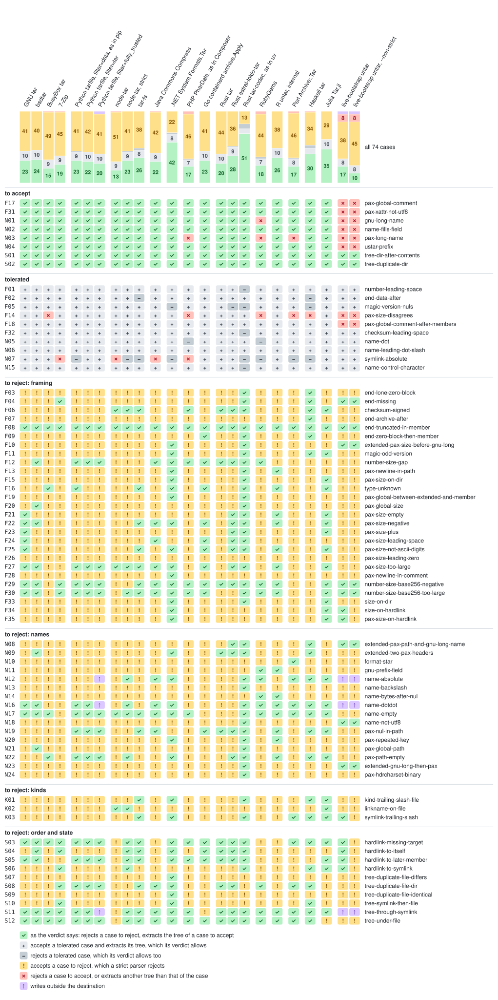

# What implementations make of the test suite

Generated by `matrix.py` from `matrix.json`: every case of [suite/archives/](../../suite/archives),
extracted by every implementation, or for libraries without an extractor listed and
applied in order. The column `strict.py` is the default policy of `scanner/strict.py`, from
what `tarscan.py` reports.

- ✅ as the verdict says: rejects a case to reject; extracts the manifest of the others
- ⚠️ accepts a case to reject. The letter is the tree it extracts: in one row, the same letter is the same tree, and different letters are trees that differ; [MATRIX.md](MATRIX.md#trees) lists them
- ⛔ rejects a tolerated case, which a strict parser may
- ❌ rejects a case to accept, or extracts another tree than its manifest
- ⏳ does not finish within 60 seconds, so it neither rejects nor extracts the case
- 💥 writes outside the destination
- ❔ not run, so not verified: the implementation was not installed where the case was run

| implementation | version | how |
|---|---|---|
| GNU tar | tar (GNU tar) 1.35 | extracts |
| bsdtar | bsdtar 3.8.10 - libarchive 3.8.10 | extracts |
| BusyBox tar | BusyBox v1.38.0 | extracts |
| 7-Zip | 7-Zip (z) 26.05 (x64) | extracts |
| Python tarfile, filter=data, as in pip | CPython 3.15.2 | extracts |
| Python tarfile, filter=tar | CPython 3.15.2 | extracts |
| Python tarfile, filter=fully_trusted | CPython 3.15.2 | extracts |
| node-tar | tar 7.5.22 | extracts |
| node-tar, strict | tar 7.5.22 | extracts |
| tar-fs | tar-fs 3.1.3, on tar-stream 3.2.2 | extracts |
| Java Commons Compress | Commons Compress 1.28.0, Expander, on Java 27.0.1.0.2 | extracts |
| .NET System.Formats.Tar | System.Formats.Tar of .NET 10.0.14, ExtractToDirectory | extracts |
| PHP PharData, as in Composer | PharData of PHP 8.5.12, as Composer's TarDownloader calls it | extracts |
| Go archive/tar | archive/tar of go1.27.3 | lists, applied in order |
| Go archive/tar, tarinsecurepath=0 | archive/tar of go1.27.3 | lists, applied in order |
| Go containerd archive.Apply | containerd v2.4.2, archive.Apply, of go1.27.3 | extracts |
| Rust tar | tar 0.4.46, unpack | extracts |
| Rust astral-tokio-tar | astral-tokio-tar 0.7.0, unpack | extracts |
| Rust tar-codec, as in uv | tar-codec 0.0.15, with the policies of uv 0.13 | extracts |
| RubyGems | RubyGems 4.0.20 of Ruby 4.0.9, extract_tar_gz | extracts |
| R untar, internal | utils::untar of R 4.6.1, tar = "internal" | extracts |
| Perl Archive::Tar | Archive::Tar 3.12 of Perl v5.44.0 | extracts |
| Haskell tar | tar 0.7.2.0, extract, of GHC 9.14 | extracts |
| Julia Tar.jl | Tar 1.10.0 of Julia 1.13.3 | extracts |
| live-bootstrap untar | mescc-tools-extra a151c245e512, built with cc | extracts |
| live-bootstrap untar, --non-strict | mescc-tools-extra a151c245e512, built with cc | extracts |

| case | strict.py | GNU tar | bsdtar | BusyBox tar | 7-Zip | Python tarfile, filter=data, as in pip | Python tarfile, filter=tar | Python tarfile, filter=fully_trusted | node-tar | node-tar, strict | tar-fs | Java Commons Compress | .NET System.Formats.Tar | PHP PharData, as in Composer | Go archive/tar | Go archive/tar, tarinsecurepath=0 | Go containerd archive.Apply | Rust tar | Rust astral-tokio-tar | Rust tar-codec, as in uv | RubyGems | R untar, internal | Perl Archive::Tar | Haskell tar | Julia Tar.jl | live-bootstrap untar | live-bootstrap untar, --non-strict |
|---|---|---|---|---|---|---|---|---|---|---|---|---|---|---|---|---|---|---|---|---|---|---|---|---|---|---|---|
| **to accept** | | | | | | | | | | | | | | | | | | | | | | | | | | | |
| [F17](https://stoppels.ch/tar/F17.html) pax-global-comment | ✅ | ✅ | ✅ | ✅ | ✅ | ✅ | ✅ | ✅ | ✅ | ✅ | ✅ | ✅ | ✅ | ✅ | ✅ | ✅ | ✅ | ✅ | ✅ | ✅ | ✅ | ✅ | ✅ | ✅ | ✅ | ❌A | ❌A |
| [F31](https://stoppels.ch/tar/F31.html) pax-xattr-not-utf8 | ✅ | ✅ | ✅ | ✅ | ✅ | ✅ | ✅ | ✅ | ✅ | ✅ | ✅ | ✅ | ✅ | ✅ | ✅ | ✅ | ✅ | ✅ | ✅ | ✅ | ✅ | ✅ | ✅ | ✅ | ✅ | ❌A | ❌A |
| [N01](https://stoppels.ch/tar/N01.html) gnu-long-name | ✅ | ✅ | ✅ | ✅ | ✅ | ✅ | ✅ | ✅ | ✅ | ✅ | ✅ | ✅ | ✅ | ✅ | ✅ | ✅ | ✅ | ✅ | ✅ | ✅ | ❌A | ✅ | ✅ | ✅ | ✅ | ❌ | ❌ |
| [N02](https://stoppels.ch/tar/N02.html) name-fills-field | ✅ | ✅ | ✅ | ✅ | ✅ | ✅ | ✅ | ✅ | ✅ | ✅ | ✅ | ✅ | ✅ | ✅ | ✅ | ✅ | ✅ | ✅ | ✅ | ✅ | ✅ | ✅ | ✅ | ✅ | ✅ | ❌A | ❌A |
| [N03](https://stoppels.ch/tar/N03.html) pax-long-name | ✅ | ✅ | ✅ | ✅ | ✅ | ✅ | ✅ | ✅ | ✅ | ✅ | ✅ | ✅ | ✅ | ❌A | ✅ | ✅ | ✅ | ✅ | ✅ | ✅ | ❌A | ✅ | ❌A | ✅ | ✅ | ❌B | ❌B |
| [N04](https://stoppels.ch/tar/N04.html) ustar-prefix | ✅ | ✅ | ✅ | ✅ | ✅ | ✅ | ✅ | ✅ | ✅ | ✅ | ✅ | ✅ | ✅ | ✅ | ✅ | ✅ | ✅ | ✅ | ✅ | ✅ | ✅ | ✅ | ✅ | ✅ | ✅ | ❌A | ❌A |
| [S01](https://stoppels.ch/tar/S01.html) tree-dir-after-contents | ✅ | ✅ | ✅ | ✅ | ✅ | ✅ | ✅ | ✅ | ✅ | ✅ | ✅ | ✅ | ✅ | ✅ | ✅ | ✅ | ✅ | ✅ | ✅ | ✅ | ✅ | ✅ | ✅ | ✅ | ✅ | ✅ | ✅ |
| [S02](https://stoppels.ch/tar/S02.html) tree-duplicate-dir | ✅ | ✅ | ✅ | ✅ | ✅ | ✅ | ✅ | ✅ | ✅ | ✅ | ✅ | ✅ | ✅ | ❌A | ✅ | ✅ | ✅ | ✅ | ✅ | ✅ | ✅ | ✅ | ✅ | ✅ | ✅ | ✅ | ✅ |
| **tolerated** | | | | | | | | | | | | | | | | | | | | | | | | | | | |
| [F01](https://stoppels.ch/tar/F01.html) number-leading-space | ✅ | ✅ | ✅ | ✅ | ✅ | ✅ | ✅ | ✅ | ✅ | ✅ | ✅ | ✅ | ✅ | ✅ | ✅ | ✅ | ✅ | ✅ | ✅ | ⛔ | ✅ | ✅ | ✅ | ✅ | ✅ | ✅ | ✅ |
| [F02](https://stoppels.ch/tar/F02.html) end-data-after | ✅ | ✅ | ✅ | ✅ | ✅ | ✅ | ✅ | ✅ | ✅ | ✅ | ⛔ | ✅ | ✅ | ✅ | ✅ | ✅ | ✅ | ✅ | ✅ | ✅ | ✅ | ✅ | ✅ | ⛔ | ✅ | ✅ | ✅ |
| [F05](https://stoppels.ch/tar/F05.html) magic-version-nuls | ✅ | ✅ | ✅ | ✅ | ✅ | ✅ | ✅ | ✅ | ✅ | ✅ | ✅ | ✅ | ⛔ | ✅ | ✅ | ✅ | ✅ | ✅ | ⛔ | ⛔ | ✅ | ✅ | ✅ | ⛔ | ✅ | ✅ | ✅ |
| [F14](https://stoppels.ch/tar/F14.html) pax-size-disagrees | ✅ | ✅ | ✅ | ❌A | ✅ | ✅ | ✅ | ✅ | ✅ | ✅ | ✅ | ✅ | ✅ | ❌A | ✅ | ✅ | ✅ | ✅ | ✅ | ✅ | ❌A | ✅ | ❌A | ❌A | ✅ | ❌B | ❌B |
| [F18](https://stoppels.ch/tar/F18.html) pax-global-comment-after-members | ✅ | ✅ | ✅ | ✅ | ✅ | ✅ | ✅ | ✅ | ✅ | ✅ | ✅ | ✅ | ✅ | ✅ | ✅ | ✅ | ✅ | ✅ | ✅ | ✅ | ✅ | ✅ | ✅ | ✅ | ✅ | ❌A | ❌A |
| [F32](https://stoppels.ch/tar/F32.html) checksum-leading-space | ✅ | ✅ | ✅ | ✅ | ✅ | ✅ | ✅ | ✅ | ✅ | ✅ | ✅ | ✅ | ✅ | ✅ | ✅ | ✅ | ✅ | ✅ | ✅ | ⛔ | ✅ | ✅ | ✅ | ✅ | ✅ | ✅ | ✅ |
| [N05](https://stoppels.ch/tar/N05.html) name-dot | ✅ | ✅ | ✅ | ✅ | ✅ | ✅ | ✅ | ✅ | ✅ | ✅ | ✅ | ✅ | ✅ | ⛔ | ✅ | ✅ | ✅ | ✅ | ✅ | ✅ | ⛔ | ✅ | ✅ | ✅ | ✅ | ✅ | ✅ |
| [N06](https://stoppels.ch/tar/N06.html) name-leading-dot-slash | ✅ | ✅ | ✅ | ✅ | ✅ | ✅ | ✅ | ✅ | ✅ | ✅ | ✅ | ✅ | ✅ | ✅ | ✅ | ✅ | ✅ | ✅ | ✅ | ✅ | ✅ | ✅ | ✅ | ✅ | ✅ | ✅ | ✅ |
| [N07](https://stoppels.ch/tar/N07.html) symlink-absolute | ✅ | ✅ | ✅ | ✅ | ❌A | ⛔ | ✅ | ✅ | ❌B | ⛔ | ⛔ | ❌C | ⛔ | ❌C | ✅ | ✅ | ✅ | ✅ | ✅ | ⛔ | ⛔ | ✅ | ⛔ | ⛔ | ✅ | ✅ | ✅ |
| **to reject: framing** | | | | | | | | | | | | | | | | | | | | | | | | | | | |
| [F03](https://stoppels.ch/tar/F03.html) end-lone-zero-block | ✅ | ⚠️A | ⚠️A | ⚠️A | ⚠️A | ⚠️A | ⚠️A | ⚠️A | ⚠️A | ⚠️A | ⚠️A | ⚠️A | ⚠️A | ⚠️A | ⚠️A | ⚠️A | ⚠️A | ⚠️A | ⚠️A | ✅ | ⚠️A | ⚠️A | ⚠️A | ✅ | ⚠️A | ⚠️A | ⚠️A |
| [F04](https://stoppels.ch/tar/F04.html) end-missing | ✅ | ⚠️A | ⚠️A | ⚠️A | ✅ | ⚠️A | ⚠️A | ⚠️A | ⚠️A | ⚠️A | ⚠️A | ⚠️A | ⚠️A | ⚠️A | ⚠️A | ⚠️A | ⚠️A | ⚠️A | ⚠️A | ✅ | ⚠️A | ⚠️A | ⚠️A | ✅ | ⚠️A | ⚠️A | ⚠️A |
| [F06](https://stoppels.ch/tar/F06.html) checksum-signed | ✅ | ⚠️A | ⚠️A | ⚠️A | ⚠️A | ⚠️A | ⚠️A | ⚠️A | ✅ | ✅ | ✅ | ⚠️A | ⚠️A | ✅ | ⚠️A | ⚠️A | ⚠️A | ✅ | ✅ | ✅ | ⚠️A | ⚠️A | ⚠️A | ✅ | ✅ | ⚠️A | ⚠️A |
| [F07](https://stoppels.ch/tar/F07.html) end-archive-after | ✅ | ⚠️A | ⚠️A | ⚠️A | ⚠️A | ⚠️A | ⚠️A | ⚠️A | ⚠️A | ⚠️A | ⚠️B | ⚠️A | ⚠️A | ⚠️A | ⚠️A | ⚠️A | ⚠️A | ⚠️A | ⚠️A | ⚠️A | ⚠️A | ⚠️A | ⚠️B | ✅ | ⚠️A | ⚠️A | ⚠️A |
| [F08](https://stoppels.ch/tar/F08.html) end-truncated-in-member | ✅ | ✅ | ✅ | ✅ | ✅ | ✅ | ✅ | ✅ | ✅ | ✅ | ✅ | ✅ | ✅ | ✅ | ✅ | ✅ | ✅ | ✅ | ✅ | ✅ | ✅ | ✅ | ✅ | ✅ | ✅ | ⚠️A | ⚠️A |
| [F09](https://stoppels.ch/tar/F09.html) end-zero-block-then-member | ✅ | ⚠️A | ⚠️A | ⚠️B | ⚠️A | ⚠️A | ⚠️A | ⚠️A | ⚠️B | ⚠️B | ⚠️B | ⚠️A | ⚠️A | ⚠️A | ✅ | ✅ | ✅ | ⚠️A | ⚠️A | ✅ | ⚠️A | ⚠️A | ⚠️B | ✅ | ⚠️A | ⚠️A | ⚠️A |
| [F10](https://stoppels.ch/tar/F10.html) extended-pax-size-before-gnu-long | ✅ | ⚠️A | ⚠️A | ⚠️B | ⚠️A | ⚠️C | ⚠️C | ⚠️C | ⚠️A | ⚠️A | ⚠️A | ⚠️A | ✅ | ⚠️B | ⚠️A | ⚠️A | ⚠️A | ⚠️A | ⚠️A | ✅ | ⚠️D | ⚠️A | ⚠️B | ⚠️B | ⚠️A | ✅ | ✅ |
| [F11](https://stoppels.ch/tar/F11.html) magic-odd-version | ✅ | ⚠️A | ⚠️A | ⚠️A | ⚠️A | ⚠️A | ⚠️A | ⚠️A | ⚠️A | ⚠️A | ⚠️A | ⚠️A | ✅ | ⚠️A | ⚠️A | ⚠️A | ⚠️A | ⚠️A | ⚠️A | ✅ | ⚠️A | ⚠️A | ⚠️A | ✅ | ✅ | ⚠️A | ⚠️A |
| [F12](https://stoppels.ch/tar/F12.html) number-size-gap | ✅ | ⚠️A | ✅ | ⚠️A | ⚠️A | ✅ | ✅ | ✅ | ⚠️A | ⚠️A | ⚠️A | ✅ | ✅ | ✅ | ✅ | ✅ | ✅ | ✅ | ✅ | ✅ | ✅ | ⚠️B | ⚠️A | ⚠️A | ⚠️A | ⚠️A | ⚠️A |
| [F13](https://stoppels.ch/tar/F13.html) pax-newline-in-path | ✅ | ⚠️A | ⚠️A | ⚠️A | ⚠️A | ⚠️A | ⚠️A | ⚠️A | ⚠️B | ⚠️B | ⚠️A | ⚠️A | ✅ | ⚠️B | ⚠️A | ⚠️A | ⚠️A | ⚠️B | ⚠️A | ✅ | ⚠️B | ✅ | ⚠️B | ⚠️A | ⚠️A | ⚠️C | ⚠️C |
| [F15](https://stoppels.ch/tar/F15.html) pax-size-on-dir | ✅ | ⚠️A | ⚠️A | ⚠️A | ⚠️B | ⚠️A | ⚠️A | ⚠️A | ⚠️A | ⚠️A | ⚠️A | ⚠️B | ✅ | ⚠️A | ⚠️A | ⚠️A | ⚠️A | ⚠️B | ⚠️B | ✅ | ⚠️A | ⚠️C | ⚠️A | ⚠️A | ✅ | ⚠️D | ⚠️D |
| [F16](https://stoppels.ch/tar/F16.html) type-unknown | ✅ | ⚠️A | ⚠️A | ✅ | ⚠️A | ✅ | ⚠️A | ⚠️A | ⚠️B | ⚠️B | ✅ | ⚠️A | ✅ | ⚠️A | ⚠️C | ⚠️C | ✅ | ⚠️A | ⚠️A | ✅ | ⚠️B | ✅ | ⚠️A | ⚠️B | ✅ | ⚠️A | ⚠️A |
| [F19](https://stoppels.ch/tar/F19.html) pax-global-between-extended-and-member | ✅ | ⚠️A | ⚠️A | ⚠️A | ⚠️A | ⚠️A | ⚠️A | ⚠️A | ⚠️A | ⚠️A | ⚠️A | ⚠️A | ✅ | ⚠️B | ⚠️B | ⚠️B | ⚠️B | ⚠️B | ⚠️B | ✅ | ⚠️B | ⚠️A | ⚠️B | ⚠️B | ⚠️A | ⚠️C | ⚠️C |
| [F20](https://stoppels.ch/tar/F20.html) pax-global-size | ✅ | ⚠️A | ✅ | ⚠️B | ⚠️B | ⚠️C | ⚠️C | ⚠️C | ⚠️A | ⚠️A | ⚠️B | ⚠️A | ⚠️B | ⚠️B | ⚠️B | ⚠️B | ⚠️B | ⚠️B | ⚠️B | ✅ | ⚠️B | ⚠️B | ⚠️B | ⚠️B | ⚠️A | ⚠️D | ⚠️D |
| [F21](https://stoppels.ch/tar/F21.html) pax-size-empty | ✅ | ✅ | ⚠️A | ⚠️B | ⚠️B | ⚠️A | ⚠️A | ⚠️A | ⚠️A | ⚠️A | ⚠️B | ⚠️B | ⚠️B | ⚠️B | ⚠️B | ⚠️B | ⚠️B | ⚠️B | ✅ | ✅ | ⚠️B | ✅ | ⚠️B | ⚠️B | ✅ | ⚠️C | ⚠️C |
| [F22](https://stoppels.ch/tar/F22.html) pax-size-negative | ✅ | ✅ | ✅ | ⚠️A | ⚠️A | ⚠️B | ⚠️B | ⚠️B | ⚠️A | ⚠️A | ✅ | ✅ | ✅ | ⚠️A | ✅ | ✅ | ✅ | ⚠️A | ✅ | ✅ | ⚠️A | ✅ | ⚠️A | ⚠️A | ✅ | ⚠️C | ⚠️C |
| [F23](https://stoppels.ch/tar/F23.html) pax-size-plus | ✅ | ✅ | ⚠️A | ⚠️A | ⚠️A | ⚠️B | ⚠️B | ⚠️B | ⚠️B | ⚠️B | ⚠️B | ⚠️B | ⚠️B | ⚠️A | ⚠️B | ⚠️B | ⚠️B | ⚠️B | ✅ | ✅ | ⚠️A | ⚠️B | ⚠️A | ⚠️A | ✅ | ⚠️C | ⚠️C |
| [F24](https://stoppels.ch/tar/F24.html) pax-size-leading-space | ✅ | ✅ | ⚠️A | ⚠️B | ⚠️B | ⚠️A | ⚠️A | ⚠️A | ⚠️A | ⚠️A | ⚠️A | ✅ | ⚠️A | ⚠️B | ✅ | ✅ | ✅ | ⚠️B | ✅ | ✅ | ⚠️B | ⚠️A | ⚠️B | ⚠️B | ⚠️A | ⚠️C | ⚠️C |
| [F25](https://stoppels.ch/tar/F25.html) pax-size-not-ascii-digits | ✅ | ✅ | ⚠️A | ⚠️A | ⚠️A | ⚠️B | ⚠️B | ⚠️B | ⚠️A | ⚠️A | ✅ | ⚠️B | ✅ | ⚠️A | ✅ | ✅ | ✅ | ⚠️A | ✅ | ✅ | ⚠️A | ✅ | ⚠️A | ⚠️A | ✅ | ⚠️C | ⚠️C |
| [F26](https://stoppels.ch/tar/F26.html) pax-size-leading-zero | ✅ | ⚠️A | ⚠️A | ⚠️B | ⚠️A | ⚠️A | ⚠️A | ⚠️A | ⚠️A | ⚠️A | ⚠️A | ⚠️A | ⚠️A | ⚠️B | ⚠️A | ⚠️A | ⚠️A | ⚠️A | ⚠️A | ⚠️A | ⚠️B | ⚠️A | ⚠️B | ⚠️B | ⚠️A | ⚠️C | ⚠️C |
| [F27](https://stoppels.ch/tar/F27.html) pax-size-too-large | ✅ | ✅ | ✅ | ⚠️A | ⚠️A | ✅ | ✅ | ✅ | ✅ | ✅ | ✅ | ✅ | ✅ | ⚠️A | ✅ | ✅ | ✅ | ⚠️A | ✅ | ✅ | ⚠️A | ✅ | ⚠️A | ⚠️A | ✅ | ⚠️B | ⚠️B |
| [F28](https://stoppels.ch/tar/F28.html) pax-newline-in-comment | ✅ | ⚠️A | ⚠️A | ⚠️A | ⚠️A | ⚠️A | ⚠️A | ⚠️A | ⚠️B | ⚠️B | ⚠️A | ⚠️A | ✅ | ⚠️A | ⚠️A | ⚠️A | ⚠️A | ⚠️A | ⚠️A | ⚠️A | ⚠️A | ⚠️B | ⚠️A | ⚠️A | ⚠️A | ⚠️C | ⚠️C |
| [F29](https://stoppels.ch/tar/F29.html) number-size-base256-negative | ✅ | ✅ | ✅ | ⚠️A | ✅ | ✅ | ✅ | ✅ | ⚠️B | ⚠️B | ✅ | ✅ | ✅ | ✅ | ✅ | ✅ | ✅ | ✅ | ✅ | ✅ | ✅ | ✅ | ⚠️B | ⚠️A | ✅ | ⚠️C | ⚠️C |
| [F30](https://stoppels.ch/tar/F30.html) number-size-base256-too-large | ✅ | ✅ | ✅ | ⚠️A | ✅ | ✅ | ✅ | ✅ | ⚠️B | ✅ | ✅ | ✅ | ✅ | ✅ | ✅ | ✅ | ✅ | ⚠️A | ⚠️A | ✅ | ✅ | ✅ | ⚠️B | ⚠️A | ✅ | ⚠️C | ⚠️C |
| [F33](https://stoppels.ch/tar/F33.html) size-on-dir | ✅ | ⚠️A | ⚠️A | ⚠️A | ⚠️A | ⚠️A | ⚠️A | ⚠️A | ⚠️A | ⚠️A | ⚠️A | ⚠️B | ✅ | ⚠️A | ⚠️A | ⚠️A | ⚠️A | ⚠️B | ⚠️B | ✅ | ⚠️B | ⚠️A | ⚠️A | ⚠️B | ✅ | ⚠️A | ⚠️A |
| [F34](https://stoppels.ch/tar/F34.html) size-on-hardlink | ✅ | ⚠️A | ⚠️B | ⚠️A | ⚠️A | ⚠️A | ⚠️A | ⚠️A | ⚠️C | ⚠️C | ⚠️C | ⚠️D | ✅ | ⚠️E | ⚠️A | ⚠️A | ⚠️A | ⚠️C | ⚠️C | ⚠️B | ⚠️F | ⚠️A | ⚠️A | ⚠️C | ✅ | ✅ | ⚠️G |
| [F35](https://stoppels.ch/tar/F35.html) pax-size-on-hardlink | ✅ | ⚠️A | ⚠️B | ⚠️A | ⚠️C | ⚠️A | ⚠️A | ⚠️A | ⚠️C | ⚠️C | ⚠️C | ⚠️D | ✅ | ⚠️E | ⚠️A | ⚠️A | ⚠️A | ⚠️C | ⚠️C | ⚠️B | ⚠️F | ⚠️G | ⚠️A | ⚠️A | ✅ | ✅ | ⚠️H |
| **to reject: names** | | | | | | | | | | | | | | | | | | | | | | | | | | | |
| [N08](https://stoppels.ch/tar/N08.html) extended-pax-path-and-gnu-long-name | ✅ | ⚠️A | ⚠️A | ⚠️A | ⚠️A | ⚠️B | ⚠️B | ⚠️B | ⚠️A | ⚠️A | ⚠️A | ⚠️B | ⚠️C | ⚠️B | ⚠️B | ⚠️B | ⚠️B | ⚠️B | ✅ | ✅ | ⚠️C | ⚠️A | ⚠️C | ✅ | ⚠️A | ✅ | ✅ |
| [N09](https://stoppels.ch/tar/N09.html) extended-two-pax-headers | ✅ | ⚠️A | ✅ | ⚠️A | ⚠️A | ⚠️B | ⚠️B | ⚠️B | ⚠️A | ⚠️A | ⚠️A | ⚠️B | ✅ | ⚠️C | ⚠️A | ⚠️A | ⚠️A | ✅ | ✅ | ✅ | ⚠️C | ⚠️A | ⚠️C | ✅ | ⚠️A | ⚠️D | ⚠️D |
| [N10](https://stoppels.ch/tar/N10.html) format-star | ✅ | ⚠️A | ⚠️A | ⚠️A | ⚠️A | ⚠️A | ⚠️A | ⚠️A | ⚠️A | ⚠️A | ⚠️A | ⚠️A | ⚠️A | ⚠️A | ⚠️A | ⚠️A | ⚠️A | ⚠️A | ⚠️A | ⚠️A | ⚠️A | ⚠️A | ✅ | ⚠️A | ⚠️A | ⚠️B | ⚠️B |
| [N11](https://stoppels.ch/tar/N11.html) gnu-prefix-field | ✅ | ⚠️A | ⚠️A | ⚠️B | ⚠️B | ⚠️B | ⚠️B | ⚠️B | ⚠️A | ⚠️A | ⚠️A | ⚠️A | ⚠️A | ⚠️B | ⚠️A | ⚠️A | ⚠️A | ⚠️A | ⚠️A | ⚠️A | ✅ | ✅ | ⚠️B | ⚠️B | ⚠️B | ⚠️A | ⚠️A |
| [N12](https://stoppels.ch/tar/N12.html) name-absolute | ✅ | ⚠️A | ⚠️A | ⚠️A | ⚠️A | ⚠️A | ⚠️A | ✅ | ⚠️A | ✅ | ⚠️A | ✅ | ✅ | ⚠️A | ⚠️B | ✅ | ⚠️A | ⚠️A | ⚠️A | ✅ | ✅ | ⚠️A | ✅ | ✅ | ✅ | ⚠️C | ⚠️C |
| [N13](https://stoppels.ch/tar/N13.html) name-backslash | ✅ | ⚠️A | ⚠️A | ⚠️A | ⚠️A | ⚠️A | ⚠️A | ⚠️A | ⚠️A | ⚠️A | ⚠️A | ⚠️A | ⚠️A | ⚠️A | ⚠️A | ⚠️A | ⚠️A | ⚠️A | ⚠️A | ✅ | ⚠️A | ⚠️A | ⚠️A | ⚠️A | ⚠️A | ⚠️A | ⚠️A |
| [N14](https://stoppels.ch/tar/N14.html) name-bytes-after-nul | ✅ | ⚠️A | ⚠️A | ⚠️A | ⚠️A | ⚠️A | ⚠️A | ⚠️A | ⚠️A | ⚠️A | ⚠️A | ⚠️A | ⚠️A | ⚠️A | ⚠️A | ⚠️A | ⚠️A | ⚠️A | ⚠️A | ⚠️A | ✅ | ✅ | ⚠️A | ⚠️A | ⚠️A | ⚠️A | ⚠️A |
| [N15](https://stoppels.ch/tar/N15.html) name-control-character | ✅ | ⚠️A | ⚠️A | ⚠️A | ⚠️A | ⚠️A | ⚠️A | ⚠️A | ⚠️A | ⚠️A | ⚠️A | ⚠️A | ⚠️A | ⚠️A | ⚠️A | ⚠️A | ⚠️A | ⚠️A | ⚠️A | ✅ | ⚠️A | ⚠️A | ⚠️A | ⚠️A | ⚠️A | ⚠️A | ⚠️A |
| [N16](https://stoppels.ch/tar/N16.html) name-dotdot | ✅ | ✅ | ✅ | ⚠️A | ⚠️B | ✅ | ✅ | 💥 | ⚠️C | ✅ | ⚠️A | ✅ | ✅ | ⚠️A | ⚠️D | ✅ | ⚠️A | ⚠️C | ⚠️C | ✅ | ✅ | ✅ | ✅ | ✅ | ✅ | 💥 | 💥 |
| [N17](https://stoppels.ch/tar/N17.html) name-empty | ✅ | ✅ | ✅ | ✅ | ⚠️A | ✅ | ✅ | ✅ | ✅ | ✅ | ✅ | ✅ | ✅ | ✅ | ⚠️B | ✅ | ⚠️B | ⚠️B | ⚠️B | ✅ | ✅ | ✅ | ✅ | ✅ | ✅ | ⚠️B | ⚠️B |
| [N18](https://stoppels.ch/tar/N18.html) name-not-utf8 | ✅ | ⚠️A | ⚠️A | ⚠️A | ⚠️A | ⚠️A | ⚠️A | ⚠️A | ⚠️B | ⚠️B | ⚠️B | ⚠️C | ⚠️B | ⚠️A | ⚠️B | ⚠️B | ⚠️A | ⚠️A | ⚠️A | ✅ | ⚠️A | ⚠️A | ⚠️A | ⚠️A | ⚠️A | ⚠️D | ⚠️D |
| [N19](https://stoppels.ch/tar/N19.html) pax-nul-in-path | ✅ | ⚠️A | ⚠️A | ⚠️A | ⚠️B | ✅ | ✅ | ✅ | ⚠️A | ⚠️A | ✅ | ✅ | ⚠️C | ⚠️B | ✅ | ✅ | ✅ | ✅ | ✅ | ✅ | ⚠️B | ✅ | ⚠️B | ✅ | ✅ | ⚠️D | ⚠️D |
| [N20](https://stoppels.ch/tar/N20.html) pax-repeated-key | ✅ | ⚠️A | ⚠️A | ⚠️A | ⚠️A | ⚠️A | ⚠️A | ⚠️A | ⚠️A | ⚠️A | ⚠️A | ⚠️A | ✅ | ⚠️B | ⚠️A | ⚠️A | ⚠️A | ⚠️C | ⚠️A | ✅ | ⚠️B | ✅ | ⚠️B | ⚠️C | ⚠️A | ⚠️D | ⚠️D |
| [N21](https://stoppels.ch/tar/N21.html) pax-global-path | ✅ | ⚠️A | ✅ | ⚠️B | ⚠️B | ⚠️A | ⚠️A | ⚠️A | ⚠️B | ⚠️B | ⚠️B | ⚠️A | ⚠️B | ⚠️B | ⚠️B | ⚠️B | ⚠️B | ⚠️B | ⚠️B | ✅ | ⚠️B | ⚠️B | ⚠️B | ⚠️B | ⚠️A | ⚠️C | ⚠️C |
| [N22](https://stoppels.ch/tar/N22.html) pax-path-empty | ✅ | ⚠️A | ⚠️A | ✅ | ⚠️B | ✅ | ✅ | ✅ | ⚠️C | ✅ | ⚠️A | ⚠️A | ✅ | ⚠️A | ⚠️A | ⚠️A | ⚠️A | ⚠️C | ✅ | ✅ | ⚠️A | ✅ | ⚠️A | ✅ | ✅ | ⚠️D | ⚠️D |
| [N23](https://stoppels.ch/tar/N23.html) extended-gnu-long-then-pax | ✅ | ⚠️A | ⚠️A | ⚠️A | ⚠️A | ⚠️A | ⚠️A | ⚠️A | ⚠️A | ⚠️A | ⚠️A | ⚠️A | ⚠️B | ⚠️A | ⚠️A | ⚠️A | ⚠️A | ⚠️A | ⚠️A | ✅ | ⚠️B | ⚠️A | ⚠️B | ⚠️B | ⚠️A | ✅ | ✅ |
| [N24](https://stoppels.ch/tar/N24.html) pax-hdrcharset-binary | ✅ | ⚠️A | ⚠️A | ⚠️A | ⚠️A | ⚠️A | ⚠️A | ⚠️A | ⚠️B | ⚠️B | ⚠️C | ⚠️C | ⚠️C | ⚠️B | ⚠️C | ⚠️C | ⚠️A | ⚠️A | ⚠️A | ✅ | ⚠️B | ⚠️B | ⚠️B | ⚠️D | ⚠️A | ⚠️E | ⚠️E |
| **to reject: kinds** | | | | | | | | | | | | | | | | | | | | | | | | | | | |
| [K01](https://stoppels.ch/tar/K01.html) kind-trailing-slash-file | ✅ | ⚠️A | ⚠️A | ⚠️A | ⚠️A | ⚠️B | ⚠️B | ⚠️B | ⚠️A | ⚠️A | ✅ | ⚠️A | ✅ | ⚠️B | ⚠️B | ⚠️B | ⚠️B | ⚠️B | ⚠️B | ✅ | ⚠️B | ⚠️B | ⚠️A | ✅ | ✅ | ⚠️A | ⚠️A |
| [K02](https://stoppels.ch/tar/K02.html) linkname-on-file | ✅ | ⚠️A | ⚠️A | ⚠️A | ⚠️A | ⚠️A | ⚠️A | ⚠️A | ✅ | ✅ | ⚠️A | ⚠️A | ⚠️A | ⚠️A | ⚠️A | ⚠️A | ⚠️A | ⚠️A | ⚠️A | ⚠️A | ⚠️A | ⚠️A | ⚠️A | ⚠️A | ✅ | ⚠️A | ⚠️A |
| [K03](https://stoppels.ch/tar/K03.html) symlink-trailing-slash | ✅ | ⚠️A | ⚠️A | ⚠️A | ⚠️A | ⚠️A | ⚠️A | ⚠️A | ⚠️A | ⚠️A | ✅ | ⚠️B | ✅ | ⚠️C | ⚠️A | ⚠️A | ⚠️A | ⚠️A | ⚠️A | ✅ | ⚠️A | ⚠️A | ✅ | ✅ | ✅ | ✅ | ⚠️D |
| **to reject: order and state** | | | | | | | | | | | | | | | | | | | | | | | | | | | |
| [S03](https://stoppels.ch/tar/S03.html) hardlink-missing-target | ✅ | ✅ | ✅ | ✅ | ✅ | ✅ | ✅ | ✅ | ⚠️A | ✅ | ✅ | ⚠️B | ✅ | ✅ | ✅ | ✅ | ✅ | ✅ | ✅ | ✅ | ⚠️A | ⚠️A | ✅ | ✅ | ✅ | ✅ | ⚠️A |
| [S04](https://stoppels.ch/tar/S04.html) hardlink-to-itself | ✅ | ⚠️A | ✅ | ⚠️A | ✅ | ⚠️A | ⚠️A | ⚠️A | ⚠️B | ✅ | ✅ | ⚠️C | ✅ | ⚠️C | ⚠️A | ⚠️A | ✅ | ✅ | ✅ | ✅ | ⚠️A | ⚠️B | ⚠️A | ⚠️A | ⚠️A | ✅ | ⚠️A |
| [S05](https://stoppels.ch/tar/S05.html) hardlink-to-later-member | ✅ | ✅ | ✅ | ⚠️A | ⚠️A | ✅ | ✅ | ✅ | ⚠️B | ✅ | ✅ | ⚠️C | ✅ | ✅ | ✅ | ✅ | ✅ | ✅ | ✅ | ✅ | ⚠️B | ⚠️B | ⚠️A | ⚠️A | ✅ | ✅ | ⚠️B |
| [S06](https://stoppels.ch/tar/S06.html) hardlink-to-symlink | ✅ | ⚠️A | ⚠️A | ⚠️A | ✅ | ⚠️B | ⚠️B | ⚠️B | ⚠️C | ✅ | ⚠️B | ⚠️D | ⚠️A | ⚠️D | ⚠️A | ⚠️A | ⚠️A | ⚠️A | ⚠️A | ✅ | ⚠️C | ⚠️A | ⚠️E | ✅ | ✅ | ✅ | ⚠️C |
| [S07](https://stoppels.ch/tar/S07.html) tree-duplicate-file-differs | ✅ | ⚠️A | ⚠️A | ⚠️A | ⚠️A | ⚠️A | ⚠️A | ⚠️A | ⚠️A | ⚠️A | ⚠️A | ⚠️A | ✅ | ⚠️A | ⚠️A | ⚠️A | ⚠️A | ⚠️A | ⚠️A | ⚠️A | ⚠️A | ⚠️A | ⚠️A | ⚠️A | ⚠️A | ⚠️A | ⚠️A |
| [S08](https://stoppels.ch/tar/S08.html) tree-duplicate-file-dir | ✅ | ⚠️A | ⚠️A | ⚠️B | ✅ | ✅ | ✅ | ✅ | ⚠️A | ⚠️A | ✅ | ✅ | ✅ | ⚠️C | ⚠️A | ⚠️A | ⚠️A | ✅ | ✅ | ⚠️A | ✅ | ⚠️A | ✅ | ✅ | ⚠️A | ⚠️B | ⚠️B |
| [S09](https://stoppels.ch/tar/S09.html) tree-duplicate-file-identical | ✅ | ⚠️A | ⚠️A | ⚠️A | ⚠️A | ⚠️A | ⚠️A | ⚠️A | ⚠️A | ⚠️A | ⚠️A | ⚠️A | ✅ | ⚠️A | ⚠️A | ⚠️A | ⚠️A | ⚠️A | ⚠️A | ⚠️A | ⚠️A | ⚠️A | ⚠️A | ⚠️A | ⚠️A | ⚠️A | ⚠️A |
| [S10](https://stoppels.ch/tar/S10.html) tree-symlink-then-file | ✅ | ⚠️A | ⚠️A | ⚠️A | ✅ | ⚠️B | ⚠️B | ⚠️B | ⚠️A | ⚠️A | ⚠️A | ⚠️A | ✅ | ⚠️A | ⚠️A | ⚠️A | ⚠️A | ⚠️A | ⚠️A | ⚠️A | ⚠️A | ⚠️A | ⚠️A | ✅ | ⚠️A | ⚠️B | ⚠️B |
| [S11](https://stoppels.ch/tar/S11.html) tree-through-symlink | ✅ | ✅ | ✅ | ✅ | ✅ | ✅ | ✅ | 💥 | ⚠️A | ✅ | ✅ | ✅ | ✅ | ✅ | ⚠️B | ⚠️B | ⚠️C | ✅ | ✅ | ✅ | ✅ | ✅ | ✅ | ✅ | ✅ | 💥 | 💥 |
| [S12](https://stoppels.ch/tar/S12.html) tree-under-file | ✅ | ✅ | ✅ | ✅ | ✅ | ✅ | ✅ | ✅ | ⚠️A | ✅ | ✅ | ✅ | ✅ | ✅ | ⚠️B | ⚠️B | ✅ | ✅ | ✅ | ✅ | ✅ | ✅ | ✅ | ✅ | ⚠️C | ⚠️A | ⚠️A |
| **total** | ✅74 | ✅32 ⚠️42 | ✅33 ⚠️41 | ✅23 ⚠️50 ❌1 | ✅27 ⚠️46 ❌1 | ✅31 ⚠️42 ⛔1 | ✅31 ⚠️43 | ✅30 ⚠️42 💥2 | ✅21 ⚠️52 ❌1 | ✅31 ⚠️42 ⛔1 | ✅33 ⚠️39 ⛔2 | ✅30 ⚠️43 ❌1 | ✅49 ⚠️23 ⛔2 | ✅22 ⚠️47 ⛔1 ❌4 | ✅29 ⚠️45 | ✅32 ⚠️42 | ✅32 ⚠️42 | ✅29 ⚠️45 | ✅36 ⚠️37 ⛔1 | ✅57 ⚠️13 ⛔4 | ✅24 ⚠️45 ⛔2 ❌3 | ✅35 ⚠️39 | ✅24 ⚠️47 ⛔1 ❌2 | ✅35 ⚠️35 ⛔3 ❌1 | ✅44 ⚠️30 | ✅19 ⚠️45 ❌8 💥2 | ✅12 ⚠️52 ❌8 💥2 |

## Trees

What the implementations that accept a case extract, where it is not its manifest: files by their size and the start of their sha256.

- F17 pax-global-comment: A: `pax_global_header` (52 B, e00a4a95), `project/`, `project/README` (6 B, 5891b5b5)
- F31 pax-xattr-not-utf8: A: `PaxHeader` (29 B, e2035909), `a` (2 B, 87428fc5)
- N01 gnu-long-name: A: `dddddddddddddddddddddddddddddddddddddddddddddddddddddddddddd/`, `dddddddddddddddddddddddddddddddddddddddddddddddddddddddddddd/fffffffffffffffffffffffffffffffffffffff` (5 B, bbdbb75b)
- N02 name-fills-field: A: `nnnnnnnnnnnnnnnnnnnnnnnnnnnnnnnnnnnnnnnnnnnnnnnnnnnnnnnnnnnnnnnnnnnnnnnnnnnnnnnnnnnnnnnnnnnnnnnnnnnn0000644` (5 B, 0e716a5f)
- N03 pax-long-name: A: `dddddddddddddddddddddddddddddddddddddddddddddddddddddddddddd/`, `dddddddddddddddddddddddddddddddddddddddddddddddddddddddddddd/fffffffffffffffffffffffffffffffffffffff` (5 B, bbdbb75b); B: `PaxHeader` (131 B, 8cc43c67), `dddddddddddddddddddddddddddddddddddddddddddddddddddddddddddd/`, `dddddddddddddddddddddddddddddddddddddddddddddddddddddddddddd/fffffffffffffffffffffffffffffffffffffff0000644` (5 B, bbdbb75b)
- N04 ustar-prefix: A: `file` (9 B, 7dd9c6f9)
- S02 tree-duplicate-dir: A: `d/`
- F14 pax-size-disagrees: A: `a` (512 B, 917dba8e); B: `PaxHeader` (9 B, 33638443), `a` (512 B, 917dba8e)
- F18 pax-global-comment-after-members: A: `a` (2 B, 87428fc5), `b` (2 B, 02638299), `pax_global_header` (19 B, 89c2f7ac)
- N07 symlink-absolute: A: `link` → `DEST/tar-minefield-nonexistent`; B: `link` → `tar-minefield-nonexistent`; C: `link` (0 B, e3b0c442)
- F03 end-lone-zero-block: A: `a` (2 B, 87428fc5)
- F04 end-missing: A: `a` (2 B, 87428fc5)
- F06 checksum-signed: A: `a` (2 B, 87428fc5)
- F07 end-archive-after: A: `a` (2 B, 87428fc5); B: `a` (2 B, 87428fc5), `hidden` (57 B, 150e5c88)
- F08 end-truncated-in-member: A: `a` (512 B, 64164443)
- F09 end-zero-block-then-member: A: `a` (2 B, 87428fc5); B: `a` (2 B, 87428fc5), `hidden` (44 B, d688c765)
- F10 extended-pax-size-before-gnu-long: A: `long-name` (512 B, 917dba8e); B: `long-name` (0 B, e3b0c442), `smuggled` (0 B, e3b0c442); C: `long-name` (512 B, 917dba8e), `short-name` (0 B, e3b0c442), `smuggled` (0 B, e3b0c442); D: `short-name` (0 B, e3b0c442), `smuggled` (0 B, e3b0c442)
- F11 magic-odd-version: A: `a` (2 B, 87428fc5)
- F12 number-size-gap: A: `a` (0 B, e3b0c442), `smuggled` (0 B, e3b0c442); B: `a` (512 B, 917dba8e)
- F13 pax-newline-in-path: A: `good\x0a1 path=evil` (12 B, a578eb49); B: `plain` (12 B, a578eb49); C: `PaxHeader` (25 B, 19000a4f), `plain` (12 B, a578eb49)
- F15 pax-size-on-dir: A: `dir/`, `dir/smuggled` (0 B, e3b0c442); B: `dir/`; C: `dir/`, `dir/smuggled` (512 B, 076a27c7); D: `PaxHeader` (12 B, 609af461), `dir/`, `dir/smuggled` (0 B, e3b0c442)
- F16 type-unknown: A: `unknown` (512 B, 917dba8e); B: nothing; C: `unknown` (other)
- F19 pax-global-between-extended-and-member: A: `from-pax` (12 B, a578eb49); B: `header-name` (12 B, a578eb49); C: `PaxHeader` (17 B, 45b5e3aa), `header-name` (12 B, a578eb49), `pax_global_header` (19 B, d0b8d0ef)
- F20 pax-global-size: A: `a` (512 B, 917dba8e); B: `a` (0 B, e3b0c442), `smuggled` (0 B, e3b0c442); C: `a` (512 B, 917dba8e), `smuggled` (512 B, 076a27c7); D: `a` (0 B, e3b0c442), `pax_global_header` (12 B, 609af461), `smuggled` (0 B, e3b0c442)
- F21 pax-size-empty: A: `a` (0 B, e3b0c442), `smuggled` (0 B, e3b0c442); B: `a` (512 B, 917dba8e); C: `PaxHeader` (8 B, facaf1d1), `a` (512 B, 917dba8e)
- F22 pax-size-negative: A: `a` (0 B, e3b0c442), `smuggled` (0 B, e3b0c442); B: nothing; C: `PaxHeader` (13 B, db55a159), `a` (0 B, e3b0c442), `smuggled` (0 B, e3b0c442)
- F23 pax-size-plus: A: `a` (0 B, e3b0c442), `smuggled` (0 B, e3b0c442); B: `a` (512 B, 917dba8e); C: `PaxHeader` (13 B, 7cc19464), `a` (0 B, e3b0c442), `smuggled` (0 B, e3b0c442)
- F24 pax-size-leading-space: A: `a` (512 B, 917dba8e); B: `a` (0 B, e3b0c442), `smuggled` (0 B, e3b0c442); C: `PaxHeader` (13 B, 62deb37f), `a` (0 B, e3b0c442), `smuggled` (0 B, e3b0c442)
- F25 pax-size-not-ascii-digits: A: `a` (0 B, e3b0c442), `smuggled` (0 B, e3b0c442); B: `a` (512 B, 917dba8e); C: `PaxHeader` (15 B, 33c621af), `a` (0 B, e3b0c442), `smuggled` (0 B, e3b0c442)
- F26 pax-size-leading-zero: A: `a` (777 B, b09d2516); B: `a` (0 B, e3b0c442), `smuggled-1` (0 B, e3b0c442), `smuggled-2` (0 B, e3b0c442); C: `PaxHeader` (13 B, fa5ee474), `a` (0 B, e3b0c442), `smuggled-1` (0 B, e3b0c442), `smuggled-2` (0 B, e3b0c442)
- F27 pax-size-too-large: A: `a` (0 B, e3b0c442), `smuggled` (0 B, e3b0c442); B: `PaxHeader` (29 B, 45e3bb26), `a` (0 B, e3b0c442), `smuggled` (0 B, e3b0c442)
- F28 pax-newline-in-comment: A: `a` (0 B, e3b0c442), `smuggled` (0 B, e3b0c442); B: `a` (512 B, 917dba8e); C: `PaxHeader` (25 B, 99e4ec94), `a` (0 B, e3b0c442), `smuggled` (0 B, e3b0c442)
- F29 number-size-base256-negative: A: `a` (512 B, 917dba8e); B: `a` (0 B, e3b0c442), `smuggled` (0 B, e3b0c442); C: nothing
- F30 number-size-base256-too-large: A: `a` (512 B, 917dba8e); B: `smuggled` (0 B, e3b0c442); C: nothing
- F33 size-on-dir: A: `dir/`, `dir/smuggled` (0 B, e3b0c442); B: `dir/`
- F34 size-on-hardlink: A: `a` (2 B, 87428fc5), `h` (2 B, 87428fc5), `smuggled` (0 B, e3b0c442); B: `a` (512 B, 917dba8e), `h` (512 B, 917dba8e); C: `a` (2 B, 87428fc5), `h` (2 B, 87428fc5); D: `a` (2 B, 87428fc5), `h` (512 B, 917dba8e); E: `a` (2 B, 87428fc5), `h` (512 B, 917dba8e), `smuggled` (0 B, e3b0c442); F: `a` (2 B, 87428fc5); G: `PaxHeader` (11 B, 2fb5f8c5), `a` (2 B, 87428fc5)
- F35 pax-size-on-hardlink: A: `a` (2 B, 87428fc5), `h` (2 B, 87428fc5), `smuggled` (0 B, e3b0c442); B: `a` (512 B, 917dba8e), `h` (512 B, 917dba8e); C: `a` (2 B, 87428fc5), `h` (2 B, 87428fc5); D: `a` (2 B, 87428fc5), `h` (512 B, 917dba8e); E: `a` (2 B, 87428fc5), `h` (0 B, e3b0c442), `smuggled` (0 B, e3b0c442); F: `a` (2 B, 87428fc5), `smuggled` (0 B, e3b0c442); G: `a` (2 B, 87428fc5), `h` (2 B, 87428fc5), `smuggled` (512 B, 076a27c7); H: `PaxHeader` (12 B, 609af461), `a` (2 B, 87428fc5), `smuggled` (0 B, e3b0c442)
- N08 extended-pax-path-and-gnu-long-name: A: `from-pax` (12 B, a578eb49); B: `from-gnu` (12 B, a578eb49); C: `from-header` (12 B, a578eb49)
- N09 extended-two-pax-headers: A: `second` (12 B, a578eb49); B: `first` (12 B, a578eb49); C: `header-name` (12 B, a578eb49); D: `PaxHeader` (15 B, 7c8761f1), `header-name` (12 B, a578eb49)
- N10 format-star: A: `dir/`, `dir/a` (2 B, 87428fc5); B: `a` (2 B, 87428fc5)
- N11 gnu-prefix-field: A: `a` (2 B, 87428fc5); B: `15000000000/`, `15000000000/a` (2 B, 87428fc5)
- N12 name-absolute: A: `tar-minefield-absolute` (89 B, 3b7f22a5); B: `/tar-minefield-absolute` (89 B, 3b7f22a5); C: nothing
- N13 name-backslash: A: `a\b` (21 B, 15acfc39)
- N14 name-bytes-after-nul: A: `a` (10 B, ef476e8d)
- N15 name-control-character: A: `a\x0ab` (21 B, 93d2f841)
- N16 name-dotdot: A: `tar-minefield-escaped` (85 B, fc503701); B: `tar-minefield/`, `tar-minefield/tar-minefield-escaped` (85 B, fc503701); C: nothing; D: `tar-minefield/`, `tar-minefield/../`, `tar-minefield/../../`, `tar-minefield/../../tar-minefield-escaped` (85 B, fc503701)
- N17 name-empty: A: `N17-name-empty` (8 B, aee7b480); B: nothing
- N18 name-not-utf8: A: `caf\xe9` (8 B, ff3f1fa3); B: `caf�` (8 B, ff3f1fa3); C: `caf?` (8 B, ff3f1fa3); D: nothing
- N19 pax-nul-in-path: A: `a` (12 B, 627be4bf); B: `header-name` (12 B, 627be4bf); C: `a_b` (12 B, 627be4bf); D: `PaxHeader` (12 B, 6f855603), `header-name` (12 B, 627be4bf)
- N20 pax-repeated-key: A: `second` (12 B, a578eb49); B: `header-name` (12 B, a578eb49); C: `first` (12 B, a578eb49); D: `PaxHeader` (29 B, 14422e4d), `header-name` (12 B, a578eb49)
- N21 pax-global-path: A: `global-name` (2 B, 02638299); B: `a` (2 B, 87428fc5), `b` (2 B, 02638299); C: `a` (2 B, 87428fc5), `b` (2 B, 02638299), `pax_global_header` (20 B, d5acb589)
- N22 pax-path-empty: A: `from-header` (12 B, a578eb49); B: `N22-pax-path-empty` (12 B, a578eb49); C: nothing; D: `PaxHeader` (8 B, b6553e3e), `from-header` (12 B, a578eb49)
- N23 extended-gnu-long-then-pax: A: `from-gnu` (12 B, a578eb49); B: `from-header` (12 B, a578eb49)
- N24 pax-hdrcharset-binary: A: `caf\xe9` (12 B, a578eb49); B: `cafe` (12 B, a578eb49); C: `caf�` (12 B, a578eb49); D: `café` (12 B, a578eb49); E: `PaxHeader` (34 B, dfe2f7e0), `cafe` (12 B, a578eb49)
- K01 kind-trailing-slash-file: A: `a/`; B: `a` (0 B, e3b0c442)
- K02 linkname-on-file: A: `a` (19 B, bc345849)
- K03 symlink-trailing-slash: A: `link` → `target`, `target/`; B: `link/`, `target/`; C: `link` (0 B, e3b0c442); D: `target/`
- S03 hardlink-missing-target: A: nothing; B: `h` (0 B, e3b0c442)
- S04 hardlink-to-itself: A: `a` (2 B, 87428fc5); B: nothing; C: `a` (0 B, e3b0c442)
- S05 hardlink-to-later-member: A: `f` (2 B, 092fcfbb), `h` (2 B, 092fcfbb); B: `f` (2 B, 092fcfbb); C: `f` (2 B, 092fcfbb), `h` (0 B, e3b0c442)
- S06 hardlink-to-symlink: A: `f` (2 B, 092fcfbb), `h` → `f`, `s` → `f`; B: `f` (2 B, 092fcfbb), `h` (2 B, 092fcfbb), `s` → `f`; C: `f` (2 B, 092fcfbb), `s` → `f`; D: `f` (2 B, 092fcfbb), `h` (0 B, e3b0c442), `s` (0 B, e3b0c442); E: `f` (2 B, 092fcfbb), `h` (0 B, e3b0c442), `s` → `f`
- S07 tree-duplicate-file-differs: A: `a` (5 B, 761d1fb1)
- S08 tree-duplicate-file-dir: A: `a/`; B: `a` (13 B, 294e546a); C: nothing
- S09 tree-duplicate-file-identical: A: `a` (5 B, a6328afc)
- S10 tree-symlink-then-file: A: `a` (28 B, d5a04bbb); B: `a` → `target`, `target` (28 B, d5a04bbb)
- S11 tree-through-symlink: A: `d/`, `d/tar-minefield-through-symlink` (89 B, 3b7f22a5); B: `d` → `..`, `d/tar-minefield-through-symlink` (89 B, 3b7f22a5); C: `d` → `..`, `tar-minefield-through-symlink` (89 B, 3b7f22a5)
- S12 tree-under-file: A: `a` (7 B, da69f286); B: `a` (7 B, da69f286), `a/b` (13 B, 8e53e378); C: `a/`, `a/b` (13 B, 8e53e378)
